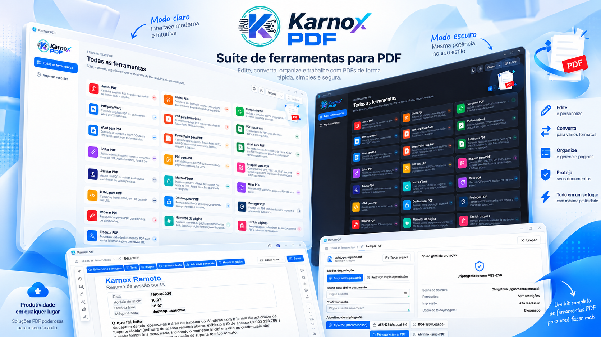
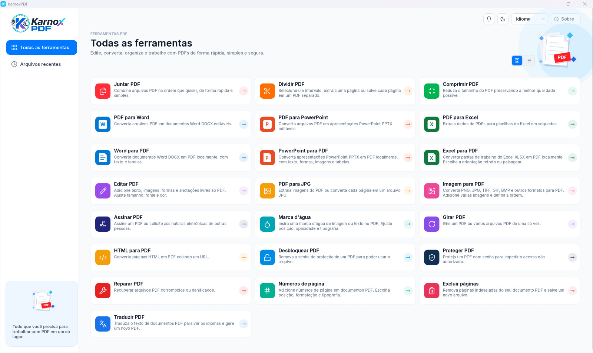

<p align="center">
  
</p>

<p align="center"><b>A PDF toolkit written in Rust.</b><br>
View, edit, convert, organize, protect and sign PDFs, all locally.</p>

<p align="center">
<a href="README.md">Português (Brasil)</a> · <a href="README.pt-PT.md">Português (Portugal)</a> · <b>English</b> · <a href="README.es.md">Español</a> · <a href="README.fr.md">Français</a>
</p>

**Version 1.0.0** · MIT or Apache-2.0 license · Windows, macOS, Linux, FreeBSD and the web (WebAssembly)

## Screenshots





## Contents

- [Install](#install)
- [Run](#run)
- [Features](#features)
- [Languages](#languages)
- [Technologies](#technologies)
- [Development](#development)
- [License](#license)

## Install

### Ready-made program (recommended)

Download the installer for your platform from the [Releases](https://github.com/euricotecnologia/karnoxpdf/releases) page:

| Platform | File |
|---|---|
| Windows 10 or later (x64, x86, ARM64) | `karnoxpdf-<version>-windows-<arch>.msi` (installer) or `...-portable.zip` (no installation) |
| macOS 11 or later (Apple silicon and Intel) | `karnoxpdf-<version>-macos-universal.dmg`: open it and drag the app to Applications |
| Linux x86_64 and aarch64 | `.AppImage`, `.deb`, `.rpm` or `.tar.gz` |
| FreeBSD 14 x86_64 | `.tar.gz` |
| Web | `karnoxpdf-web-<version>.zip`: a static site, just host the folder |

**In this version (1.0.0) the release includes the portable package for Windows x64** (`karnoxpdf-1.0.0-windows-x64-portable.zip`: unzip and run `karnoxpdf.exe`). Packages for the other platforms are built by the `release.yml` workflow and published as they become ready; until then, build from source (see below).

On Windows there is also an installer with a setup wizard (`karnoxpdf-1.0.0-windows-x64-setup.exe`),
built from `packaging/windows/karnoxpdf-setup.iss` with Inno Setup.

### Build from source

Requirements:

- [Rust](https://rustup.rs) 1.90 or later.
- **Windows:** MSVC build tools (Visual Studio Build Tools, "Desktop development with C++" workload).
- **Linux:** X11 or Wayland development libraries required by egui/wgpu.

```bash
git clone https://github.com/euricotecnologia/karnoxpdf.git
cd karnoxpdf
cargo build --release -p karnoxpdf -p karnoxpdf-cli
```

The executables are in `target/release/`: `karnoxpdf` (the app) and `karnoxpdf-cli` (the command
line), with the `.exe` extension on Windows.

Japanese and Chinese fonts are an optional build input (a folder of fonts set in the
`CRAFT_FONTS_DIR` variable). Without them the app builds and works; only Japanese and Chinese labels
show boxes instead of characters.

```bash
CRAFT_FONTS_DIR=/path/to/fonts cargo build --release -p karnoxpdf
```

For the web version, see [packaging/web/README.md](packaging/web/README.md).

## Run

### Application

```bash
cargo run --release -p karnoxpdf                  # opens the app
cargo run --release -p karnoxpdf -- file.pdf      # opens a PDF directly
```

Or open the installed `karnoxpdf` from the Start menu, Launchpad or the applications menu. You can
also drag PDFs into the window or use **Open with** in your file manager.

On start you see **All tools**, with a card for each task, and **Recent files**. Each PDF opens in
a tab. The language and the theme (light, dark or system) are chosen in
**Menu > Edit > Preferences…** or with the shortcuts in the top bar, and are saved in `app.ron`.

Handy shortcut: `Ctrl+K` (⌘K on macOS) opens the command palette, which reaches any function.

### Command line

```bash
karnoxpdf-cli --help        # help and subcommands
karnoxpdf-cli tools         # lists the automation tools
karnoxpdf-cli run --script steps.json --root FOLDER   # runs a JSON script
karnoxpdf-cli mcp           # MCP server (optional) over stdio
```

### Logs and diagnostics

The app writes `logs/karnoxpdf.log` in its settings folder (Windows: `%APPDATA%\KarnoxPDF\data\logs\`).
Environment variables such as `RUST_LOG` are described in [docs/development.md](docs/development.md).

## Features

Every function below works locally, without sending the document to any service. The only
exception is **Translate PDF**, which sends the text to the online MyMemory service. The app does
not check for updates by itself: **Help > Check for updates** is manual.

### Home screen tools

Merge PDF · Split PDF · Compress PDF · PDF to Word · PDF to PowerPoint · PDF to Excel ·
Word to PDF · PowerPoint to PDF · Excel to PDF · Edit PDF · PDF to JPG · Image to PDF ·
Sign PDF · Watermark · Rotate PDF · HTML to PDF · Unlock PDF · Protect PDF · Repair PDF ·
Page numbers · Delete pages · Translate PDF.

### Open, save and file safety

- Opens PDFs from the menu, by drag and drop, from the command line and with the system **Open with**; local recent-files list.
- Opens damaged files by rebuilding the cross-reference table, and records and shows every repair made (**Repair PDF** tool).
- Rejects corrupt or hostile files without crashing; a defective page never takes the program down.
- Opens documents encrypted with RC4 (40/128-bit), AES-128 and AES-256 (revisions 2 to 6), asks for the user or owner password and honors the permissions.
- Incremental save (keeps the original bytes, atomic write), Save as with a full rewrite and garbage collection, objects packed into object streams, and encrypted documents are written back encrypted.
- Unlimited undo and redo for every edit (even after saving), multi-step edits are atomic, and the Edit menu names the step.
- Periodic autosave, recovery of unsaved work after a crash, a prompt when closing with changes and an unsaved marker on the tabs.
- Revert to the last saved version; list the file's revisions and view an earlier revision read-only.
- Signed documents are always saved incrementally, preserving the signatures.

### View

- Tabs per document, thumbnails, bookmarks, attachments, layers (optional content), form fields, comments and signatures, each in its own panel.
- Single page or two-page view (with cover), continuous scrolling, full screen and a reading mode without toolbars.
- Zoom by shortcuts, mouse wheel or pinch gesture, around the cursor; zoom to a percentage, actual size, fit width, fit height, fit page and fit visible content; marquee zoom tool.
- Rotate the view without changing the file; go to a page by number or logical label (i, ii, 1, 2…); previous and next view.
- Hand tool, automatic scrolling, text selection and copy in reading order, select all text on the page and snapshot (copies a region as an image).
- Find text in the document (whole words, case-sensitive), results list, next and previous, and an advanced search window.
- Follow links and destinations; show comment text on hover.
- Rendering of text, vectors and images (JPEG, JPEG 2000, JBIG2, CCITT), CID and CJK fonts, Type 3 fonts, gradients, patterns, blend modes, soft masks and transparency groups; tiled rendering for deep zoom.
- Light, dark and system themes; Brazilian Portuguese, European Portuguese, English, Spanish and French interface languages.
- Platform keyboard shortcuts, command palette and screen reader support (AccessKit).
- A web version of the same app, in WebAssembly.

### Organize pages and document

- Thumbnail grid for organizing; select by click, Ctrl/⌘ and Shift, by range, odd/even and portrait/landscape.
- Rotate pages (by range, odd/even and orientation), delete, move, reorder by dragging, duplicate, copy, cut and paste pages.
- Insert blank pages, insert from another file and replace pages with pages from another file.
- Extract pages to a new document or to separate files, with the option to delete them afterwards.
- Split every N pages, before chosen pages, by file size or by top-level bookmarks.
- Merge files choosing the pages of each; creates one bookmark per file, keeps attachments, interactive form fields, layers and links, and stores identical fonts and images only once.
- Crop pages by dragging a rectangle and set page boxes (crop, trim, bleed, art).
- Bookmarks: add, rename, reorder, nest, delete, expand and collapse, and set the destination.
- Page labels (style, prefix, start) and page numbers with position, format and typography.
- Document properties: title, author, subject, keywords, language, reading direction, font list (type and embedding) and initial view (layout, magnification, panels, window).

### Edit content

- Add text boxes, images, shapes and free annotations; everything stays editable (move, resize, rotate, flip, crop, replace an image keeping position and size, save an image to a file).
- Format text: font, size, color, bold, italic, underline, alignment (left, center, right, justified), line, paragraph and character spacing, and horizontal scaling; formatting panel.
- Edit existing text in place, with paragraph and block detection, reflow inside the paragraph box and reuse of embedded fonts (or substitution with a warning).
- Select, move, resize, recolor and delete vector paths.
- Header and footer (ranges: all, range, even, odd; page number and date tokens), update or remove.
- Text, image or PDF-page watermark, with rotation, opacity, scale, position and visibility on screen and in print; update or remove.
- Background (color or file), update or remove.
- Bates numbering.
- Links: create web and page links, create links from URLs in the text, properties and appearance, remove all.
- Actions: go to page view, open web link and show/hide field.

### Convert and create

- **To PDF:** Word (.docx), PowerPoint (.pptx) and Excel (.xlsx), converted locally, without installing another program; HTML (pasting a URL); images (JPEG, PNG, multi-page TIFF, GIF, BMP, JPEG 2000); plain text; clipboard; blank PDF.
- **Word to PDF:** paragraphs, formatting, tables and simple shapes.
- **PowerPoint to PDF:** one page per slide, with layouts, masters, themes, text, bullets, shapes, images and tables.
- **Excel to PDF:** prints all visible sheets the way Excel prints them (paper, margins, scale, page breaks, print titles, header and footer), with number formats, fills, borders and alignment; choice of portrait or landscape.
- **Export PDF to:** Word (.docx), PowerPoint (.pptx), Excel (.xlsx, with table detection), HTML, RTF, plain text (reading order with columns, RTL and CJK), PNG, JPEG and TIFF; export all embedded images.
- **PDF to JPG:** a dedicated workspace with a choice of resolution, quality and page range, exporting to a folder.
- Resolution options (embedded, 72 or custom) and compression when converting images.

### Comments and review

- Sticky note, free text (typewriter), text box with formatted text and callout text.
- Highlight, underline, strike through and squiggly-underline text; area highlight; insert-text and replace-text proposals.
- Freehand drawing with eraser, line, arrow, connected lines, rectangle, oval, polygon and cloud, with all ten line-ending styles and dashed or cloudy borders.
- Standard, business, dynamic (name and date), "Sign here" and custom stamps from images or PDF pages; attach a file as a comment.
- Reply to comments in threads, set review status (accepted, rejected, cancelled, completed), mark with a checkmark, lock, review history.
- Comments panel with search, filter (type, author, status, color, checkmark) and sort (page, author, date, type, color); hide or show all.
- Properties (appearance, author, subject), properties bar, make the current properties the tool default and author name from the preferences.
- Import and export comments in FDF and XFDF, generate a comment summary as a new PDF and flatten comments into the page content.
- **Measurement:** distance, perimeter and area, scale calibrated per view, snapping to paths, endpoints, midpoints and intersections, information panel and CSV export.

### Forms and JavaScript

- Fill text fields, check boxes, radio buttons, lists and drop-downs, with a date picker; toggle boxes and radios; Tab between fields; highlight existing fields and the required ones.
- Automatic field detection; clear or reset the form; flatten form fields.
- Fill & Sign: add text on flat forms, marks (check, cross, dot, line), today's date, typed, drawn or image signature and initials, with flattening on save.
- **Create forms (Prepare mode):** text fields, check boxes, radio buttons, lists, drop-downs, date, image, button and digital signature; move, resize, duplicate across pages, align, center, distribute, match sizes, rename and lock; name fields from nearby labels; preview mode for testing.
- Field properties: general (name, tooltip, visibility, read-only, required), appearance (border, fill, font), position, options per type, actions per trigger, format, validation and calculation; tab order (row, column, structure, manual) and calculation order.
- Acrobat-standard formats and validations: numbers and currency, percentage, date and time, special formats (ZIP code, phone, SSN, free mask), range validation, sum, product, average, minimum, maximum and simplified field notation, in Acrobat's event order.
- JavaScript engine (sandboxed) with a subset of the Acrobat object model: keystroke, validate, calculate and format scripts, document scripts, action buttons, console and an on/off switch.
- Data exchange: import and export FDF and XFDF, form data as XML, CSV and tab-delimited text, and merge data files into a spreadsheet.
- XFA forms: template reading, display and filling, XML data import and export.

### Protect

- Protect with a password to open, with a password strength meter.
- Restrict editing and printing with a permissions password (printing, changes, copying, accessibility).
- Choose the encryption compatibility: RC4 40/128-bit, AES-128 or AES-256; encrypt everything except metadata.
- Remove security (Unlock PDF) and view the security properties (method, which password opened it, each permission).
- **Redaction:** mark text, areas, images and whole pages; find text and redact; ready-made patterns (phone, email, card, SSN, dates); fill color and overlay text; when applied, it removes text glyphs, image pixels, vector paths, XObject content, annotations and fields under the mark, and text in tags and alternate text; verifies that no residue remains.
- Remove hidden information (selectable categories) and Sanitize document.

### Digital signatures

- Sign with a PKCS #12 certificate (.p12/.pfx) or with macOS Keychain identities; create a self-signed digital ID.
- Visible signatures (by drawing a rectangle), invisible or in an existing field, with configurable appearance (text, image, name), reason, location and contact.
- PAdES/CAdES B-B (SHA-256/384/512, no SHA-1 for new signatures), timestamp, long-term validation with revocation (OCSP and CRL) and document timestamp signature (RFC 3161).
- Certify a document (DocMDP) with a choice of allowed changes.
- Validate all signatures, including when the document opens; status (valid, unknown, invalid); signatures panel with a tree per revision; message bar for signed or certified documents.
- List of changes made after signing, view the signed version, certificate viewer and export, trusted certificates store and import, and choice of the verification time.

### OCR

- Recognize text on the current page, in a range, in the whole file or in several files, skipping pages that already have text.
- Searchable image output: an invisible text layer, with the original image untouched (exact mode).
- Document language selection (Latin alphabet).

### Optimize and standards

- **Reduce file size** with quality presets, and the advanced **PDF Optimizer**.
- Downsample color, grayscale and monochrome images and recompress (JPEG, JPEG 2000, Flate), only when the result is smaller.
- Compress the structure into object streams, re-encode streams in Flate (replacing LZW), merge resources and flatten layers.
- Discard: JavaScript, comments, forms and multimedia, document information and metadata, tags, bookmarks, thumbnails, attachments, alternate images, print settings and private application data; remove invalid links, bookmarks and destinations; flatten form fields.
- Audit space usage.
- Verify PDF/A conformance (1 to 4), save as PDF/A (1b, 2b, 3b, 4), a standards panel showing the declared conformance and a choice of output intents.

### Print

- Print dialog with preview, printer choice and properties (CUPS), copies and collation.
- All pages, the current one or a range (including by label), odd or even and reverse order.
- Fit, actual size, shrink oversized pages and custom scale; automatic orientation; grayscale.
- Multiple pages per sheet, booklet, tiled poster with overlap and cut marks, double-sided printing and cut-and-stack imposition.
- Print the document, comments, stamps or only form fields, and produce a print-ready PDF.

### Accessibility

- Full accessibility checker with all 32 rules (tags, alternate text, reading order, tables, lists, headings, language, contrast, forms, bookmarks and others), report, and the Fix, Skip, Explain and Re-check actions.
- Set the document language, alternate text figure by figure (with a decorative option) and show the document title in the window.

### Compare

- Compare two files: text and visual differences, and a summary report as a PDF.

### Automation and integration

- **Command line:** inspect, render and extract text; edit, merge, extract and split; `run` calls any automation tool or a JSON script; batch processing of files and folders.
- Optional **MCP server** over stdio, with page text and image resources, for use by AI agents.
- More than 120 automation tools with JSON schemas, covering every command, with file access confined to a root folder.
- **Action Wizard:** create, edit and run guided actions on files, with ready-made actions (optimize scanned documents, prepare for distribution).
- UI control channel (inspect, click, type, keys, commands and screenshots), off by default.
- A single command registry feeds menus, shortcuts, the palette and automation; disabled commands explain why.
- Preferences generated from a schema (language, page display, JavaScript).

## Languages

The KarnoxPDF interface is available in:

| Language | Code |
|---|---|
| Brazilian Portuguese | `pt-br` |
| European Portuguese | `pt-pt` |
| English | `en` |
| Spanish | `es` |
| French | `fr` |

**How the language is chosen**

- **Automatic (default):** follows the system language. On Linux and FreeBSD it reads `LC_ALL`, `LC_MESSAGES` or `LANG`; on macOS, the preferred-languages list; on Windows, the display languages in order of preference.
- `pt_BR` uses Brazilian Portuguese, `pt_PT` uses European Portuguese, and other Portuguese locales use Brazilian Portuguese. Regional variants of French and Spanish use the language's catalog.
- If the system language has no catalog, the interface appears in English.
- You can change it at any time in **Menu > Edit > Preferences… > General > Interface language**, or from the language menu in the top bar. The change applies immediately and is saved in `app.ron`.

Commands, content and file names of the documents are not translated. Error messages that come from the operating system appear as the system delivers them, inside a translated frame. See [docs/localization.md](docs/localization.md).

## Technologies

| Layer | Technology |
|---|---|
| Language | Rust (2024 edition, minimum version 1.90), `unsafe` forbidden, no hand-written JavaScript/TypeScript |
| Interface | egui/eframe with wgpu (Direct3D 12 on Windows, Metal, Vulkan and OpenGL), screen reader via AccessKit |
| Web | WebAssembly with `wasm-bindgen` and Trunk |
| Own PDF core | `cos` (tolerant reader, incremental and full writing), `filters`, `crypt` |
| Rendering | `hayro`, in patched copies in the [`vendor/`](vendor/README.md) folder |
| Signatures | RustCrypto (X.509, CMS, PKCS #12, ECDSA, RSA) and `aws-lc-rs` |
| Form JavaScript | `boa_engine`, sandboxed |
| OCR | `ocrs` with `rten` |
| Images and fonts | `image`, `png`, `tiff`, `skrifa` |
| Quality | `cargo-deny` (permissive licenses only), fuzzing, UI tests with kittest, GitHub Actions |
| Packaging | MSI (WiX) and Inno Setup on Windows, DMG on macOS, AppImage/deb/rpm on Linux, FreeBSD and web |

The code is split into 29 crates in [`crates/`](crates/), three applications in [`apps/`](apps/)
(`karnoxpdf`, `karnoxpdf-cli`, `karnoxpdf-web`) and the build tool in [`xtask/`](xtask/).

## Development

```bash
cargo fmt --check
cargo clippy --workspace -- -D warnings
cargo test --workspace
cargo xtask assets      # checks the origin and license of every asset (icon, image, font)
cargo xtask parity      # progress against the Acrobat Pro feature list
```

Read [AGENTS.md](AGENTS.md) before contributing: rules for visual assets, *clean-room* development
(nothing is copied or disassembled from another product) and "never panic" on hostile files. More
details in [docs/development.md](docs/development.md), [docs/releasing.md](docs/releasing.md) and
[ROADMAP.md](ROADMAP.md).

## License

Dual license, your choice: [MIT](LICENSE-MIT) or [Apache-2.0](LICENSE-APACHE). Credits and licenses
of third-party components are in [THIRD_PARTY_NOTICES.md](THIRD_PARTY_NOTICES.md) and
[ATTRIBUTION.md](ATTRIBUTION.md).

KarnoxPDF is not an Adobe product.
