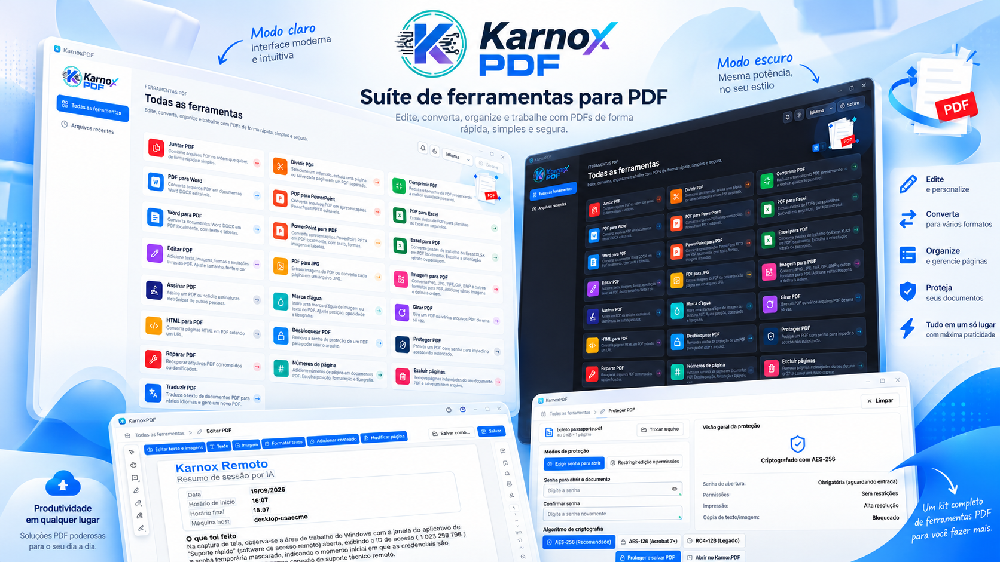
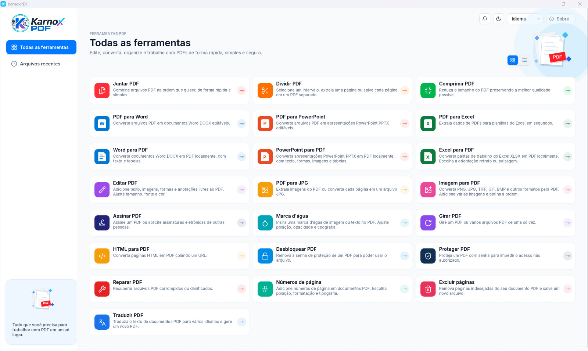

<p align="center">
  
</p>

<p align="center"><b>Una suite de herramientas para PDF escrita en Rust.</b><br>
Visualice, edite, convierta, organice, proteja y firme PDF, todo de forma local.</p>

<p align="center">
<a href="README.md">Português (Brasil)</a> · <a href="README.pt-PT.md">Português (Portugal)</a> · <a href="README.en.md">English</a> · <b>Español</b> · <a href="README.fr.md">Français</a>
</p>

**Versión 1.0.0** · Licencia MIT o Apache-2.0 · Windows, macOS, Linux, FreeBSD y web (WebAssembly)

## Capturas de pantalla





## Índice

- [Instalar](#instalar)
- [Ejecutar](#ejecutar)
- [Funciones](#funciones)
- [Idiomas](#idiomas)
- [Tecnologías](#tecnologías)
- [Desarrollo](#desarrollo)
- [Licencia](#licencia)

## Instalar

### Programa ya compilado (recomendado)

Descargue el instalador de su plataforma desde la página de [Releases](https://github.com/euricotecnologia/karnoxpdf/releases):

| Plataforma | Archivo |
|---|---|
| Windows 10 o superior (x64, x86, ARM64) | `karnoxpdf-<versión>-windows-<arq>.msi` (instalador) o `...-portable.zip` (sin instalación) |
| macOS 11 o superior (Apple silicon e Intel) | `karnoxpdf-<versión>-macos-universal.dmg`: ábralo y arrastre la aplicación a Aplicaciones |
| Linux x86_64 y aarch64 | `.AppImage`, `.deb`, `.rpm` o `.tar.gz` |
| FreeBSD 14 x86_64 | `.tar.gz` |
| Web | `karnoxpdf-web-<versión>.zip`: sitio estático, basta con alojar la carpeta |

**En esta versión (1.0.0) la release incluye el paquete portátil para Windows x64** (`karnoxpdf-1.0.0-windows-x64-portable.zip`: descomprímalo y ejecute `karnoxpdf.exe`). Los paquetes de las demás plataformas los genera el flujo `release.yml` y se publican a medida que están listos; hasta entonces, compile desde el código fuente (vea más abajo).

En Windows también hay un instalador con asistente (`karnoxpdf-1.0.0-windows-x64-setup.exe`),
generado con `packaging/windows/karnoxpdf-setup.iss` mediante Inno Setup.

### Compilar desde el código fuente

Requisitos:

- [Rust](https://rustup.rs) 1.90 o superior.
- **Windows:** herramientas de compilación MSVC (Visual Studio Build Tools, carga de trabajo «Desarrollo para el escritorio con C++»).
- **Linux:** bibliotecas de desarrollo de X11 o Wayland que exigen egui/wgpu.

```bash
git clone https://github.com/euricotecnologia/karnoxpdf.git
cd karnoxpdf
cargo build --release -p karnoxpdf -p karnoxpdf-cli
```

Los ejecutables quedan en `target/release/`: `karnoxpdf` (la aplicación) y `karnoxpdf-cli` (la línea
de comandos), con la extensión `.exe` en Windows.

Las fuentes japonesas y chinas son una entrada opcional de compilación (una carpeta de fuentes
indicada en la variable `CRAFT_FONTS_DIR`). Sin ellas la aplicación compila y funciona; solo las
etiquetas en japonés y chino aparecen con cuadros en lugar de caracteres.

```bash
CRAFT_FONTS_DIR=/ruta/de/las/fuentes cargo build --release -p karnoxpdf
```

Para la versión web, consulte [packaging/web/README.md](packaging/web/README.md).

## Ejecutar

### Aplicación

```bash
cargo run --release -p karnoxpdf                  # abre la aplicación
cargo run --release -p karnoxpdf -- archivo.pdf   # abre un PDF directamente
```

O abra `karnoxpdf` ya instalado desde el menú Inicio, el Launchpad o el menú de aplicaciones.
También puede arrastrar PDF a la ventana o usar **Abrir con** en el gestor de archivos.

Al iniciar verá **Todas las herramientas**, con una tarjeta para cada tarea, y **Archivos recientes**.
Cada PDF se abre en una pestaña. El idioma y el tema (claro, oscuro o del sistema) se eligen en
**Menú > Editar > Preferencias…** o con los accesos directos de la barra superior, y se guardan en `app.ron`.

Atajo útil: `Ctrl+K` (⌘K en macOS) abre la paleta de comandos, que da acceso a cualquier función.

### Línea de comandos

```bash
karnoxpdf-cli --help        # ayuda y subcomandos
karnoxpdf-cli tools         # lista las herramientas de automatización
karnoxpdf-cli run --script pasos.json --root CARPETA   # ejecuta un guion JSON
karnoxpdf-cli mcp           # servidor MCP (opcional) por stdio
```

### Registros y diagnóstico

La aplicación escribe `logs/karnoxpdf.log` en su carpeta de configuración (Windows: `%APPDATA%\KarnoxPDF\data\logs\`).
Las variables de entorno como `RUST_LOG` se describen en [docs/development.md](docs/development.md).

## Funciones

Todas las funciones siguientes se ejecutan de forma local, sin enviar el documento a ningún
servicio. La única excepción es **Traducir PDF**, que envía el texto al servicio en línea MyMemory.
La aplicación no busca actualizaciones por sí sola: **Ayuda > Buscar actualizaciones** es manual.

### Herramientas de la pantalla de inicio

Unir PDF · Dividir PDF · Comprimir PDF · PDF a Word · PDF a PowerPoint · PDF a Excel ·
Word a PDF · PowerPoint a PDF · Excel a PDF · Editar PDF · PDF a JPG · Imagen a PDF ·
Firmar PDF · Marca de agua · Girar PDF · HTML a PDF · Desbloquear PDF · Proteger PDF · Reparar PDF ·
Números de página · Eliminar páginas · Traducir PDF.

### Abrir, guardar y seguridad del archivo

- Abre PDF desde el menú, arrastrando y soltando, desde la línea de comandos y con **Abrir con** del sistema; lista local de archivos recientes.
- Abre archivos dañados reconstruyendo la tabla de referencias cruzadas, y registra y muestra cada reparación realizada (herramienta **Reparar PDF**).
- Rechaza archivos corruptos u hostiles sin bloquearse; una página defectuosa nunca derriba el programa.
- Abre documentos cifrados con RC4 (40/128 bits), AES-128 y AES-256 (revisiones 2 a 6), solicita la contraseña de usuario o de propietario y respeta los permisos.
- Guardado incremental (conserva los bytes originales, escritura atómica), Guardar como con reescritura completa y recolección de basura, objetos compactados en flujos de objetos, y los documentos cifrados se vuelven a escribir cifrados.
- Deshacer y rehacer ilimitados en cada edición (incluso después de guardar), las ediciones de varios pasos son atómicas y el menú Editar indica el nombre del paso.
- Autoguardado periódico, recuperación del trabajo no guardado tras un fallo, aviso al cerrar con cambios y marcador de no guardado en las pestañas.
- Volver a la última versión guardada; listar las revisiones del archivo y ver una revisión anterior en solo lectura.
- Los documentos firmados siempre se guardan de forma incremental, preservando las firmas.

### Visualizar

- Pestañas por documento, miniaturas, marcadores, adjuntos, capas (contenido opcional), campos de formulario, comentarios y firmas, cada uno en su panel.
- Página única o dos páginas (con portada), desplazamiento continuo, pantalla completa y modo de lectura sin barras de herramientas.
- Zoom con atajos, rueda del ratón o gesto de pellizco, alrededor del cursor; zoom a un porcentaje, tamaño real, ajustar al ancho, al alto, a la página y al contenido visible; herramienta de zoom por área.
- Girar la vista sin modificar el archivo; ir a una página por número o etiqueta lógica (i, ii, 1, 2…); vista anterior y siguiente.
- Herramienta Mano, desplazamiento automático, selección y copia de texto en orden de lectura, seleccionar todo el texto de la página e instantánea (copia una región como imagen).
- Buscar texto en el documento (palabras completas, distinguir mayúsculas), lista de resultados, siguiente y anterior, y ventana de búsqueda avanzada.
- Seguir enlaces y destinos; mostrar el texto de los comentarios al pasar el ratón.
- Renderizado de texto, vectores e imágenes (JPEG, JPEG 2000, JBIG2, CCITT), fuentes CID y CJK, fuentes Type 3, degradados, patrones, modos de fusión, máscaras suaves y grupos de transparencia; renderizado por teselas para zoom profundo.
- Temas claro, oscuro y del sistema; idiomas portugués de Brasil, portugués de Portugal, inglés, español y francés.
- Atajos de teclado por plataforma, paleta de comandos y compatibilidad con lectores de pantalla (AccessKit).
- Versión web de la misma aplicación, en WebAssembly.

### Organizar páginas y documento

- Cuadrícula de miniaturas para organizar; seleccionar con clic, Ctrl/⌘ y Mayús, por intervalo, pares/impares y vertical/horizontal.
- Girar páginas (por intervalo, pares/impares y orientación), eliminar, mover, reordenar arrastrando, duplicar, copiar, cortar y pegar páginas.
- Insertar páginas en blanco, insertar desde otro archivo y sustituir páginas por páginas de otro archivo.
- Extraer páginas a un documento nuevo o a archivos separados, con la opción de eliminarlas después.
- Dividir cada N páginas, antes de páginas elegidas, por tamaño de archivo o por marcadores de nivel superior.
- Unir archivos eligiendo las páginas de cada uno; crea un marcador por archivo, conserva adjuntos, campos de formulario interactivos, capas y enlaces, y guarda una sola vez las fuentes e imágenes idénticas.
- Recortar páginas arrastrando un rectángulo y definir cuadros de página (recorte, acabado, sangrado, arte).
- Marcadores: añadir, renombrar, reordenar, anidar, eliminar, expandir y contraer, y definir el destino.
- Etiquetas de página (estilo, prefijo, inicio) y números de página con posición, formato y tipografía.
- Propiedades del documento: título, autor, asunto, palabras clave, idioma, dirección de lectura, lista de fuentes (tipo e incrustación) y vista inicial (diseño, ampliación, paneles, ventana).

### Editar contenido

- Añadir cuadros de texto, imágenes, formas y anotaciones libres; todo sigue siendo editable (mover, cambiar tamaño, girar, voltear, recortar, sustituir una imagen manteniendo posición y tamaño, guardar una imagen en un archivo).
- Dar formato al texto: fuente, tamaño, color, negrita, cursiva, subrayado, alineación (izquierda, centro, derecha, justificado), espaciado de líneas, de párrafos y de caracteres, y escala horizontal; panel de formato.
- Editar el texto existente en el lugar, con detección de párrafos y bloques, reflujo dentro del cuadro del párrafo y reutilización de fuentes incrustadas (o sustitución con aviso).
- Seleccionar, mover, cambiar el tamaño, recolorear y eliminar trazados vectoriales.
- Encabezado y pie de página (intervalos: todas, rango, pares, impares; marcadores de número de página y fecha), actualizar o quitar.
- Marca de agua de texto, imagen o página de PDF, con rotación, opacidad, escala, posición y visibilidad en pantalla y en la impresión; actualizar o quitar.
- Fondo (color o archivo), actualizar o quitar.
- Numeración Bates.
- Enlaces: crear enlaces web y de página, crear enlaces a partir de URL en el texto, propiedades y aspecto, quitar todos.
- Acciones: ir a una vista de página, abrir un enlace web y mostrar u ocultar un campo.

### Convertir y crear

- **A PDF:** Word (.docx), PowerPoint (.pptx) y Excel (.xlsx), convertidos de forma local, sin instalar otro programa; HTML (pegando una URL); imágenes (JPEG, PNG, TIFF de varias páginas, GIF, BMP, JPEG 2000); texto sin formato; portapapeles; PDF en blanco.
- **Word a PDF:** párrafos, formato, tablas y formas sencillas.
- **PowerPoint a PDF:** una página por diapositiva, con diseños, patrones, temas, textos, viñetas, formas, imágenes y tablas.
- **Excel a PDF:** imprime todas las hojas visibles como las imprime Excel (papel, márgenes, escala, saltos de página, títulos de impresión, encabezado y pie), con formatos de número, rellenos, bordes y alineación; elección de orientación vertical u horizontal.
- **Exportar PDF a:** Word (.docx), PowerPoint (.pptx), Excel (.xlsx, con detección de tablas), HTML, RTF, texto sin formato (orden de lectura con columnas, RTL y CJK), PNG, JPEG y TIFF; exportar todas las imágenes incrustadas.
- **PDF a JPG:** área propia con elección de resolución, calidad e intervalo de páginas, exportando a una carpeta.
- Opciones de resolución (incrustada, 72 o personalizada) y de compresión al convertir imágenes.

### Comentarios y revisión

- Nota adhesiva, texto libre (máquina de escribir), cuadro de texto con texto con formato y texto de llamada.
- Resaltar, subrayar, tachar y subrayar con ondulado el texto; resaltado de área; propuestas de inserción y sustitución de texto.
- Dibujo a mano alzada con goma de borrar, línea, flecha, líneas conectadas, rectángulo, óvalo, polígono y nube, con los diez estilos de extremo de línea y bordes discontinuos o en nube.
- Sellos estándar, de negocios, dinámicos (nombre y fecha), «Firme aquí» y personalizados a partir de imágenes o páginas de PDF; adjuntar un archivo como comentario.
- Responder a comentarios en hilos, definir el estado de revisión (aceptado, rechazado, cancelado, completado), marcar con una marca de verificación, bloquear, historial de revisión.
- Panel de comentarios con búsqueda, filtro (tipo, autor, estado, color, marca) y orden (página, autor, fecha, tipo, color); ocultar o mostrar todos.
- Propiedades (aspecto, autor, asunto), barra de propiedades, convertir las propiedades actuales en las predeterminadas de la herramienta y nombre del autor tomado de las preferencias.
- Importar y exportar comentarios en FDF y XFDF, generar un resumen de los comentarios como un PDF nuevo y acoplar los comentarios al contenido de la página.
- **Medición:** distancia, perímetro y área, escala calibrada por vista, ajuste a trazados, extremos, puntos medios e intersecciones, panel de información y exportación a CSV.

### Formularios y JavaScript

- Rellenar campos de texto, casillas de verificación, botones de opción, listas y menús desplegables, con selector de fecha; alternar casillas y opciones; Tab entre campos; resaltar los campos existentes y los obligatorios.
- Detección automática de campos; borrar o restablecer el formulario; acoplar los campos del formulario.
- Rellenar y firmar: añadir texto en formularios planos, marcas (visto, cruz, punto, línea), la fecha de hoy, firma e iniciales escritas, dibujadas o de imagen, con acoplado al guardar.
- **Crear formularios (modo Preparar):** campos de texto, casillas de verificación, botones de opción, listas, menús desplegables, fecha, imagen, botón y firma digital; mover, cambiar tamaño, duplicar entre páginas, alinear, centrar, distribuir, igualar tamaños, renombrar y bloquear; nombrar campos a partir de etiquetas cercanas; modo de vista previa para probar.
- Propiedades del campo: general (nombre, información sobre herramientas, visibilidad, solo lectura, obligatorio), aspecto (borde, relleno, fuente), posición, opciones por tipo, acciones por desencadenador, formato, validación y cálculo; orden de tabulación (fila, columna, estructura, manual) y orden de cálculo.
- Formatos y validaciones del estándar de Acrobat: números y moneda, porcentaje, fecha y hora, formatos especiales (código postal, teléfono, SSN, máscara libre), validación de intervalo, suma, producto, media, mínimo, máximo y notación simplificada de campos, en el orden de eventos de Acrobat.
- Motor JavaScript (en un entorno aislado) con un subconjunto del modelo de objetos de Acrobat: scripts de teclado, validación, cálculo y formato, scripts de documento, botones de acción, consola e interruptor para activarlo o desactivarlo.
- Intercambio de datos: importar y exportar FDF y XFDF, datos de formulario en XML, CSV y texto delimitado por tabulaciones, y combinar archivos de datos en una hoja de cálculo.
- Formularios XFA: lectura de la plantilla, visualización y relleno, importación y exportación de datos XML.

### Proteger

- Proteger con contraseña para abrir, con medidor de seguridad de la contraseña.
- Restringir la edición y la impresión con una contraseña de permisos (impresión, cambios, copia, accesibilidad).
- Elegir la compatibilidad del cifrado: RC4 40/128 bits, AES-128 o AES-256; cifrar todo excepto los metadatos.
- Quitar la seguridad (Desbloquear PDF) y ver las propiedades de seguridad (método, qué contraseña lo abrió, cada permiso).
- **Redacción:** marcar texto, áreas, imágenes y páginas enteras; buscar texto y redactar; patrones predefinidos (teléfono, correo electrónico, tarjeta, SSN, fechas); color de relleno y texto superpuesto; al aplicar, elimina glifos de texto, píxeles de imagen, trazados vectoriales, contenido de XObjects, anotaciones y campos bajo la marca, y texto en etiquetas y textos alternativos; verifica que no queden residuos.
- Quitar información oculta (categorías seleccionables) y Sanear documento.

### Firmas digitales

- Firmar con un certificado PKCS #12 (.p12/.pfx) o con identidades del llavero de macOS; crear una identidad digital autofirmada.
- Firmas visibles (dibujando un rectángulo), invisibles o en un campo existente, con aspecto configurable (texto, imagen, nombre), motivo, ubicación y contacto.
- PAdES/CAdES B-B (SHA-256/384/512, sin SHA-1 en firmas nuevas), sello de tiempo, validación a largo plazo con revocación (OCSP y CRL) y firma de documento con sello de tiempo (RFC 3161).
- Certificar un documento (DocMDP) con elección de los cambios permitidos.
- Validar todas las firmas, también al abrir el documento; estado (válida, desconocida, no válida); panel de firmas con árbol por revisión; barra de mensajes para documentos firmados o certificados.
- Lista de los cambios hechos tras la firma, ver la versión firmada, visor y exportación de certificados, almacén e importación de certificados de confianza, y elección del momento de verificación.

### OCR

- Reconocer texto en la página actual, en un intervalo, en todo el archivo o en varios archivos, omitiendo las páginas que ya tienen texto.
- Salida de imagen con capacidad de búsqueda: una capa de texto invisible, con la imagen original intacta (modo exacto).
- Selección del idioma del documento (alfabeto latino).

### Optimizar y estándares

- **Reducir el tamaño del archivo** con ajustes de calidad preestablecidos, y **Optimizador de PDF** avanzado.
- Reducir la resolución de imágenes en color, grises y monocromas y volver a comprimir (JPEG, JPEG 2000, Flate), solo cuando resulta más pequeño.
- Compactar la estructura en flujos de objetos, recodificar flujos en Flate (sustituyendo LZW), combinar recursos y acoplar capas.
- Descartar: JavaScript, comentarios, formularios y multimedia, información del documento y metadatos, etiquetas, marcadores, miniaturas, adjuntos, imágenes alternativas, configuración de impresión y datos privados de aplicaciones; quitar enlaces, marcadores y destinos no válidos; acoplar los campos de formulario.
- Auditar el uso del espacio.
- Verificar la conformidad con PDF/A (1 a 4), guardar como PDF/A (1b, 2b, 3b, 4), panel de estándares que muestra la conformidad declarada y elección de intenciones de salida.

### Imprimir

- Cuadro de diálogo de impresión con vista previa, elección de impresora y propiedades (CUPS), copias e intercalado.
- Todas las páginas, la actual o un intervalo (también por etiqueta), pares o impares y orden inverso.
- Ajustar, tamaño real, reducir páginas grandes y escala personalizada; orientación automática; escala de grises.
- Varias páginas por hoja, folleto, póster en teselas con solapamiento y marcas de corte, impresión a doble cara e imposición con corte y apilado.
- Imprimir el documento, los comentarios, los sellos o solo los campos de formulario, y generar un PDF listo para imprimir.

### Accesibilidad

- Verificador de accesibilidad completo, con las 32 reglas (etiquetas, texto alternativo, orden de lectura, tablas, listas, títulos, idioma, contraste, formularios, marcadores y otras), informe, y las acciones Corregir, Omitir, Explicar y Volver a comprobar.
- Definir el idioma del documento, texto alternativo figura por figura (con opción decorativa) y mostrar el título del documento en la ventana.

### Comparar

- Comparar dos archivos: diferencias de texto y visuales, e informe resumen en PDF.

### Automatización e integración

- **Línea de comandos:** inspeccionar, renderizar y extraer texto; editar, unir, extraer y dividir; `run` invoca cualquier herramienta de automatización o un guion JSON; procesamiento por lotes de archivos y carpetas.
- **Servidor MCP** opcional por stdio, con recursos de texto e imágenes de página, para su uso por agentes de IA.
- Más de 120 herramientas de automatización con esquemas JSON, que cubren todos los comandos, con acceso a archivos limitado a una carpeta raíz.
- **Asistente de acciones:** crear, editar y ejecutar acciones guiadas sobre archivos, con acciones predefinidas (optimizar documentos digitalizados, preparar para distribución).
- Canal de control de la interfaz (inspeccionar, hacer clic, escribir, teclas, comandos y capturas de pantalla), desactivado de forma predeterminada.
- Un único registro de comandos alimenta los menús, los atajos, la paleta y la automatización; los comandos desactivados explican el motivo.
- Preferencias generadas a partir de un esquema (idioma, visualización de páginas, JavaScript).

## Idiomas

La interfaz de KarnoxPDF está disponible en:

| Idioma | Código |
|---|---|
| Portugués de Brasil | `pt-br` |
| Portugués de Portugal | `pt-pt` |
| Inglés | `en` |
| Español | `es` |
| Francés | `fr` |

**Cómo se elige el idioma**

- **Automático (predeterminado):** sigue el idioma del sistema. En Linux y FreeBSD lee `LC_ALL`, `LC_MESSAGES` o `LANG`; en macOS, la lista de idiomas preferidos; en Windows, los idiomas de visualización por orden de preferencia.
- `pt_BR` usa portugués de Brasil, `pt_PT` usa portugués de Portugal, y las demás variantes de portugués usan el de Brasil. Las variantes regionales del francés y del español usan el catálogo del idioma.
- Si el idioma del sistema no tiene catálogo, la interfaz aparece en inglés.
- Puede cambiarlo en cualquier momento en **Menú > Editar > Preferencias… > General > Idioma de la interfaz**, o desde el menú de idioma de la barra superior. El cambio se aplica al instante y se guarda en `app.ron`.

Los comandos, el contenido y los nombres de archivo de los documentos no se traducen. Los mensajes de error que provienen del sistema operativo aparecen tal como los entrega el sistema, dentro de un marco traducido. Consulte [docs/localization.md](docs/localization.md).

## Tecnologías

| Capa | Tecnología |
|---|---|
| Lenguaje | Rust (edición 2024, versión mínima 1.90), `unsafe` prohibido, sin JavaScript/TypeScript escrito a mano |
| Interfaz | egui/eframe con wgpu (Direct3D 12 en Windows, Metal, Vulkan y OpenGL), lector de pantalla mediante AccessKit |
| Web | WebAssembly con `wasm-bindgen` y Trunk |
| Núcleo PDF propio | `cos` (lector tolerante, escritura incremental y completa), `filters`, `crypt` |
| Renderizado | `hayro`, en copias corregidas en la carpeta [`vendor/`](vendor/README.md) |
| Firmas | RustCrypto (X.509, CMS, PKCS #12, ECDSA, RSA) y `aws-lc-rs` |
| JavaScript de formularios | `boa_engine`, en un entorno aislado |
| OCR | `ocrs` con `rten` |
| Imágenes y fuentes | `image`, `png`, `tiff`, `skrifa` |
| Calidad | `cargo-deny` (solo licencias permisivas), fuzzing, pruebas de interfaz con kittest, GitHub Actions |
| Empaquetado | MSI (WiX) e Inno Setup en Windows, DMG en macOS, AppImage/deb/rpm en Linux, FreeBSD y web |

El código se divide en 29 crates en [`crates/`](crates/), tres aplicaciones en [`apps/`](apps/)
(`karnoxpdf`, `karnoxpdf-cli`, `karnoxpdf-web`) y la herramienta de compilación en [`xtask/`](xtask/).

## Desarrollo

```bash
cargo fmt --check
cargo clippy --workspace -- -D warnings
cargo test --workspace
cargo xtask assets      # comprueba el origen y la licencia de cada recurso (icono, imagen, fuente)
cargo xtask parity      # progreso respecto a la lista de funciones de Acrobat Pro
```

Lea [AGENTS.md](AGENTS.md) antes de contribuir: reglas para recursos visuales, desarrollo
*clean-room* (no se copia ni se desensambla nada de otro producto) y «nunca entrar en pánico» ante
archivos hostiles. Más detalles en [docs/development.md](docs/development.md),
[docs/releasing.md](docs/releasing.md) y [ROADMAP.md](ROADMAP.md).

## Licencia

Licencia doble, a su elección: [MIT](LICENSE-MIT) o [Apache-2.0](LICENSE-APACHE). Los créditos y las
licencias de componentes de terceros están en [THIRD_PARTY_NOTICES.md](THIRD_PARTY_NOTICES.md) y
[ATTRIBUTION.md](ATTRIBUTION.md).

KarnoxPDF no es un producto de Adobe.
