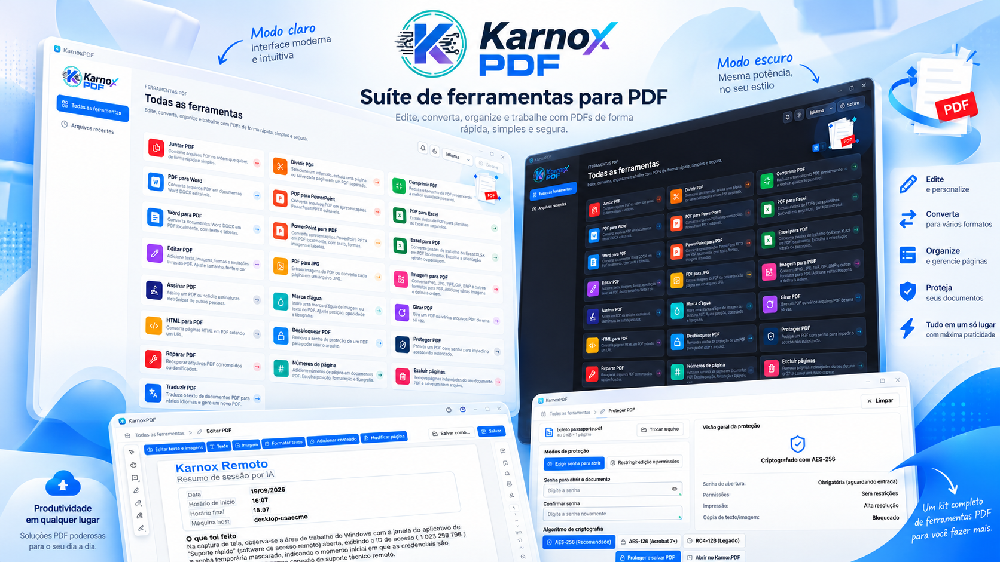
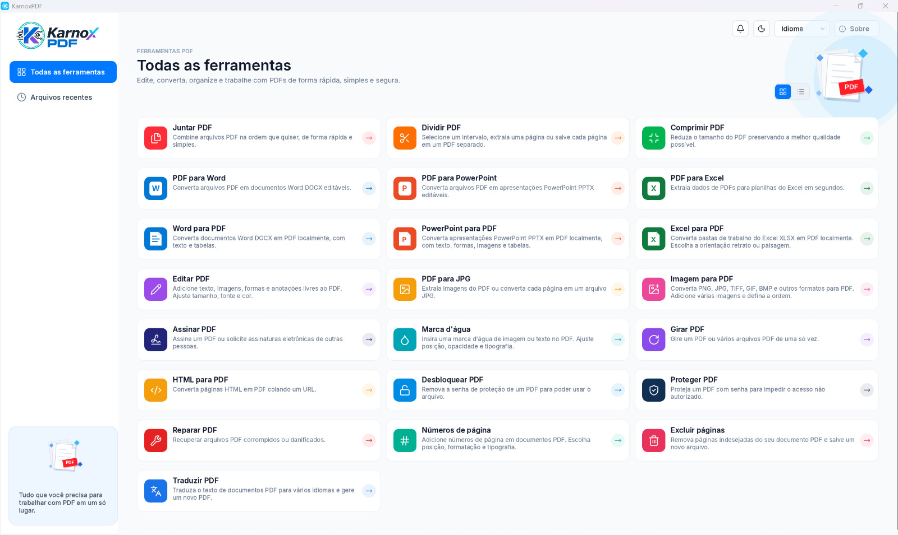

<p align="center">
  
</p>

<p align="center"><b>Une suite d'outils PDF écrite en Rust.</b><br>
Affichez, modifiez, convertissez, organisez, protégez et signez vos PDF, entièrement en local.</p>

<p align="center">
<a href="README.md">Português (Brasil)</a> · <a href="README.pt-PT.md">Português (Portugal)</a> · <a href="README.en.md">English</a> · <a href="README.es.md">Español</a> · <b>Français</b>
</p>

**Version 1.0.0** · Licence MIT ou Apache-2.0 · Windows, macOS, Linux, FreeBSD et web (WebAssembly)

## Captures d'écran





## Sommaire

- [Installer](#installer)
- [Lancer](#lancer)
- [Fonctionnalités](#fonctionnalités)
- [Langues](#langues)
- [Technologies](#technologies)
- [Développement](#développement)
- [Licence](#licence)

## Installer

### Programme prêt à l'emploi (recommandé)

Téléchargez le programme d'installation de votre plateforme depuis la page des [Releases](https://github.com/euricotecnologia/karnoxpdf/releases) :

| Plateforme | Fichier |
|---|---|
| Windows 10 ou supérieur (x64, x86, ARM64) | `karnoxpdf-<version>-windows-<arch>.msi` (installateur) ou `...-portable.zip` (sans installation) |
| macOS 11 ou supérieur (Apple silicon et Intel) | `karnoxpdf-<version>-macos-universal.dmg` : ouvrez-le et faites glisser l'application dans Applications |
| Linux x86_64 et aarch64 | `.AppImage`, `.deb`, `.rpm` ou `.tar.gz` |
| FreeBSD 14 x86_64 | `.tar.gz` |
| Web | `karnoxpdf-web-<version>.zip` : site statique, il suffit d'héberger le dossier |

**Dans cette version (1.0.0), la release contient le paquet portable pour Windows x64** (`karnoxpdf-1.0.0-windows-x64-portable.zip` : décompressez-le et lancez `karnoxpdf.exe`). Les paquets des autres plateformes sont produits par le workflow `release.yml` et publiés au fur et à mesure ; d'ici là, compilez à partir du code source (voir ci-dessous).

Sous Windows, il existe aussi un installateur avec assistant (`karnoxpdf-1.0.0-windows-x64-setup.exe`),
généré à partir de `packaging/windows/karnoxpdf-setup.iss` avec Inno Setup.

### Compiler à partir du code source

Prérequis :

- [Rust](https://rustup.rs) 1.90 ou supérieur.
- **Windows :** outils de compilation MSVC (Visual Studio Build Tools, charge de travail « Développement Desktop en C++ »).
- **Linux :** bibliothèques de développement X11 ou Wayland requises par egui/wgpu.

```bash
git clone https://github.com/euricotecnologia/karnoxpdf.git
cd karnoxpdf
cargo build --release -p karnoxpdf -p karnoxpdf-cli
```

Les exécutables se trouvent dans `target/release/` : `karnoxpdf` (l'application) et `karnoxpdf-cli`
(la ligne de commande), avec l'extension `.exe` sous Windows.

Les polices japonaises et chinoises sont une entrée de compilation facultative (un dossier de
polices indiqué dans la variable `CRAFT_FONTS_DIR`). Sans elles, l'application se compile et
fonctionne ; seuls les libellés en japonais et en chinois s'affichent avec des cadres à la place des
caractères.

```bash
CRAFT_FONTS_DIR=/chemin/des/polices cargo build --release -p karnoxpdf
```

Pour la version web, consultez [packaging/web/README.md](packaging/web/README.md).

## Lancer

### Application

```bash
cargo run --release -p karnoxpdf                  # ouvre l'application
cargo run --release -p karnoxpdf -- fichier.pdf   # ouvre directement un PDF
```

Ou ouvrez `karnoxpdf` une fois installé depuis le menu Démarrer, le Launchpad ou le menu des
applications. Vous pouvez aussi faire glisser des PDF dans la fenêtre ou utiliser **Ouvrir avec**
dans le gestionnaire de fichiers.

Au démarrage, vous voyez **Tous les outils**, avec une carte pour chaque tâche, et **Fichiers récents**.
Chaque PDF s'ouvre dans un onglet. La langue et le thème (clair, sombre ou du système) se choisissent
dans **Menu > Édition > Préférences…** ou avec les raccourcis de la barre supérieure, et sont
enregistrés dans `app.ron`.

Raccourci utile : `Ctrl+K` (⌘K sous macOS) ouvre la palette de commandes, qui donne accès à toutes les fonctions.

### Ligne de commande

```bash
karnoxpdf-cli --help        # aide et sous-commandes
karnoxpdf-cli tools         # liste les outils d'automatisation
karnoxpdf-cli run --script etapes.json --root DOSSIER   # exécute un script JSON
karnoxpdf-cli mcp           # serveur MCP (facultatif) via stdio
```

### Journaux et diagnostic

L'application écrit `logs/karnoxpdf.log` dans son dossier de configuration (Windows : `%APPDATA%\KarnoxPDF\data\logs\`).
Les variables d'environnement comme `RUST_LOG` sont décrites dans [docs/development.md](docs/development.md).

## Fonctionnalités

Toutes les fonctions ci-dessous s'exécutent en local, sans envoyer le document à aucun service. La
seule exception est **Traduire le PDF**, qui envoie le texte au service en ligne MyMemory.
L'application ne vérifie pas les mises à jour toute seule : **Aide > Rechercher des mises à jour** est manuel.

### Outils de l'écran d'accueil

Fusionner PDF · Diviser PDF · Compresser PDF · PDF vers Word · PDF vers PowerPoint · PDF vers Excel ·
Word vers PDF · PowerPoint vers PDF · Excel vers PDF · Modifier PDF · PDF vers JPG · Image vers PDF ·
Signer PDF · Filigrane · Pivoter PDF · HTML vers PDF · Déverrouiller PDF · Protéger PDF · Réparer PDF ·
Numéros de page · Supprimer des pages · Traduire PDF.

### Ouvrir, enregistrer et sécurité du fichier

- Ouvre les PDF par le menu, par glisser-déposer, en ligne de commande et avec **Ouvrir avec** du système ; liste locale des fichiers récents.
- Ouvre les fichiers endommagés en reconstruisant la table des références croisées, et consigne et affiche chaque réparation effectuée (outil **Réparer PDF**).
- Rejette les fichiers corrompus ou hostiles sans planter ; une page défectueuse ne fait jamais tomber le programme.
- Ouvre les documents chiffrés en RC4 (40/128 bits), AES-128 et AES-256 (révisions 2 à 6), demande le mot de passe utilisateur ou propriétaire et respecte les autorisations.
- Enregistrement incrémentiel (conserve les octets d'origine, écriture atomique), Enregistrer sous avec réécriture complète et ramasse-miettes, objets regroupés en flux d'objets, et les documents chiffrés sont réécrits chiffrés.
- Annuler et rétablir sans limite pour chaque modification (même après l'enregistrement), les modifications en plusieurs étapes sont atomiques et le menu Édition indique le nom de l'étape.
- Enregistrement automatique périodique, récupération du travail non enregistré après un plantage, invite à la fermeture avec des modifications et marqueur « non enregistré » sur les onglets.
- Revenir à la dernière version enregistrée ; lister les révisions du fichier et afficher une révision antérieure en lecture seule.
- Les documents signés sont toujours enregistrés de façon incrémentielle, ce qui préserve les signatures.

### Afficher

- Onglets par document, miniatures, signets, pièces jointes, calques (contenu facultatif), champs de formulaire, commentaires et signatures, chacun dans son panneau.
- Page unique ou deux pages (avec couverture), défilement continu, plein écran et mode lecture sans barres d'outils.
- Zoom par raccourcis, molette de la souris ou geste de pincement, autour du curseur ; zoom à un pourcentage, taille réelle, ajuster à la largeur, à la hauteur, à la page et au contenu visible ; outil de zoom par zone.
- Pivoter l'affichage sans modifier le fichier ; aller à une page par son numéro ou son étiquette logique (i, ii, 1, 2…) ; vue précédente et suivante.
- Outil Main, défilement automatique, sélection et copie de texte dans l'ordre de lecture, sélection de tout le texte de la page et instantané (copie une zone comme image).
- Rechercher du texte dans le document (mots entiers, respect de la casse), liste des résultats, suivant et précédent, et fenêtre de recherche avancée.
- Suivre les liens et les destinations ; afficher le texte des commentaires au survol.
- Rendu du texte, des vecteurs et des images (JPEG, JPEG 2000, JBIG2, CCITT), polices CID et CJK, polices Type 3, dégradés, motifs, modes de fusion, masques progressifs et groupes de transparence ; rendu par tuiles pour le zoom profond.
- Thèmes clair, sombre et du système ; langues portugais du Brésil, portugais du Portugal, anglais, espagnol et français.
- Raccourcis clavier selon la plateforme, palette de commandes et prise en charge des lecteurs d'écran (AccessKit).
- Version web de la même application, en WebAssembly.

### Organiser les pages et le document

- Grille de miniatures pour organiser ; sélection par clic, Ctrl/⌘ et Maj, par plage, pages paires/impaires et portrait/paysage.
- Pivoter des pages (par plage, paires/impaires et orientation), supprimer, déplacer, réorganiser par glisser, dupliquer, copier, couper et coller des pages.
- Insérer des pages vierges, insérer depuis un autre fichier et remplacer des pages par des pages d'un autre fichier.
- Extraire des pages vers un nouveau document ou vers des fichiers séparés, avec l'option de les supprimer ensuite.
- Diviser toutes les N pages, avant des pages choisies, par taille de fichier ou par signets de premier niveau.
- Fusionner des fichiers en choisissant les pages de chacun ; crée un signet par fichier, conserve les pièces jointes, les champs de formulaire interactifs, les calques et les liens, et ne stocke qu'une fois les polices et images identiques.
- Rogner des pages en faisant glisser un rectangle et définir les zones de page (rognage, découpe, fond perdu, art).
- Signets : ajouter, renommer, réordonner, imbriquer, supprimer, développer et réduire, et définir la destination.
- Étiquettes de page (style, préfixe, début) et numéros de page avec position, format et typographie.
- Propriétés du document : titre, auteur, sujet, mots-clés, langue, sens de lecture, liste des polices (type et incorporation) et affichage initial (disposition, grossissement, panneaux, fenêtre).

### Modifier le contenu

- Ajouter des zones de texte, des images, des formes et des annotations libres ; tout reste modifiable (déplacer, redimensionner, pivoter, retourner, rogner, remplacer une image en gardant position et taille, enregistrer une image dans un fichier).
- Mettre en forme le texte : police, taille, couleur, gras, italique, souligné, alignement (gauche, centré, droite, justifié), interligne, espacement des paragraphes et des caractères, et mise à l'échelle horizontale ; panneau de mise en forme.
- Modifier le texte existant sur place, avec détection des paragraphes et des blocs, reflux dans la zone du paragraphe et réutilisation des polices incorporées (ou substitution avec avertissement).
- Sélectionner, déplacer, redimensionner, recolorer et supprimer des tracés vectoriels.
- En-tête et pied de page (plages : toutes, intervalle, paires, impaires ; marqueurs de numéro de page et de date), mettre à jour ou supprimer.
- Filigrane de texte, d'image ou de page PDF, avec rotation, opacité, échelle, position et visibilité à l'écran et à l'impression ; mettre à jour ou supprimer.
- Arrière-plan (couleur ou fichier), mettre à jour ou supprimer.
- Numérotation Bates.
- Liens : créer des liens web et de page, créer des liens à partir des URL du texte, propriétés et apparence, tout supprimer.
- Actions : aller à une vue de page, ouvrir un lien web et afficher/masquer un champ.

### Convertir et créer

- **Vers PDF :** Word (.docx), PowerPoint (.pptx) et Excel (.xlsx), convertis en local, sans installer d'autre programme ; HTML (en collant une URL) ; images (JPEG, PNG, TIFF multipage, GIF, BMP, JPEG 2000) ; texte brut ; presse-papiers ; PDF vierge.
- **Word vers PDF :** paragraphes, mise en forme, tableaux et formes simples.
- **PowerPoint vers PDF :** une page par diapositive, avec dispositions, masques, thèmes, textes, puces, formes, images et tableaux.
- **Excel vers PDF :** imprime toutes les feuilles visibles comme Excel les imprime (papier, marges, échelle, sauts de page, titres d'impression, en-tête et pied de page), avec formats numériques, remplissages, bordures et alignement ; choix du mode portrait ou paysage.
- **Exporter le PDF vers :** Word (.docx), PowerPoint (.pptx), Excel (.xlsx, avec détection des tableaux), HTML, RTF, texte brut (ordre de lecture avec colonnes, RTL et CJK), PNG, JPEG et TIFF ; exporter toutes les images incorporées.
- **PDF vers JPG :** espace dédié avec choix de la résolution, de la qualité et de la plage de pages, exportant vers un dossier.
- Options de résolution (incorporée, 72 ou personnalisée) et de compression lors de la conversion d'images.

### Commentaires et révision

- Note adhésive, texte libre (machine à écrire), zone de texte avec texte mis en forme et texte d'appel.
- Surligner, souligner, barrer et souligner en ondulé le texte ; surlignage de zone ; propositions d'insertion et de remplacement de texte.
- Dessin à main levée avec gomme, ligne, flèche, lignes connectées, rectangle, ovale, polygone et nuage, avec les dix styles d'extrémité de ligne et des bordures en pointillés ou en nuage.
- Tampons standard, professionnels, dynamiques (nom et date), « Signez ici » et personnalisés à partir d'images ou de pages PDF ; joindre un fichier comme commentaire.
- Répondre aux commentaires en fils de discussion, définir l'état de révision (accepté, rejeté, annulé, terminé), marquer d'une coche, verrouiller, historique de révision.
- Panneau des commentaires avec recherche, filtre (type, auteur, état, couleur, coche) et tri (page, auteur, date, type, couleur) ; masquer ou afficher tout.
- Propriétés (apparence, auteur, sujet), barre de propriétés, faire des propriétés actuelles celles par défaut de l'outil et nom de l'auteur tiré des préférences.
- Importer et exporter les commentaires en FDF et XFDF, générer un résumé des commentaires sous forme de nouveau PDF et aplatir les commentaires dans le contenu de la page.
- **Mesure :** distance, périmètre et surface, échelle calibrée par vue, accrochage aux tracés, extrémités, milieux et intersections, panneau d'informations et export CSV.

### Formulaires et JavaScript

- Remplir des champs de texte, cases à cocher, boutons radio, listes et menus déroulants, avec sélecteur de date ; basculer les cases et les boutons radio ; Tab entre les champs ; mettre en évidence les champs existants et les champs obligatoires.
- Détection automatique des champs ; effacer ou réinitialiser le formulaire ; aplatir les champs de formulaire.
- Remplir et signer : ajouter du texte sur des formulaires plats, des marques (coche, croix, point, ligne), la date du jour, une signature et des initiales saisies, dessinées ou en image, avec aplatissement à l'enregistrement.
- **Créer des formulaires (mode Préparer) :** champs de texte, cases à cocher, boutons radio, listes, menus déroulants, date, image, bouton et signature numérique ; déplacer, redimensionner, dupliquer d'une page à l'autre, aligner, centrer, répartir, uniformiser les tailles, renommer et verrouiller ; nommer les champs à partir des libellés voisins ; mode aperçu pour tester.
- Propriétés du champ : général (nom, info-bulle, visibilité, lecture seule, obligatoire), apparence (bordure, remplissage, police), position, options par type, actions par déclencheur, format, validation et calcul ; ordre de tabulation (ligne, colonne, structure, manuel) et ordre de calcul.
- Formats et validations au standard Acrobat : nombres et devises, pourcentage, date et heure, formats spéciaux (code postal, téléphone, SSN, masque libre), validation de plage, somme, produit, moyenne, minimum, maximum et notation simplifiée des champs, dans l'ordre des événements d'Acrobat.
- Moteur JavaScript (en bac à sable) avec un sous-ensemble du modèle d'objets d'Acrobat : scripts de saisie, de validation, de calcul et de format, scripts de document, boutons d'action, console et interrupteur d'activation.
- Échange de données : importer et exporter FDF et XFDF, données de formulaire en XML, CSV et texte délimité par tabulations, et fusionner des fichiers de données dans un tableur.
- Formulaires XFA : lecture du modèle, affichage et remplissage, import et export de données XML.

### Protéger

- Protéger par un mot de passe d'ouverture, avec indicateur de robustesse du mot de passe.
- Restreindre la modification et l'impression avec un mot de passe d'autorisations (impression, modifications, copie, accessibilité).
- Choisir la compatibilité du chiffrement : RC4 40/128 bits, AES-128 ou AES-256 ; tout chiffrer sauf les métadonnées.
- Supprimer la sécurité (Déverrouiller PDF) et voir les propriétés de sécurité (méthode, mot de passe utilisé à l'ouverture, chaque autorisation).
- **Biffure :** marquer du texte, des zones, des images et des pages entières ; rechercher du texte et le biffer ; motifs prêts à l'emploi (téléphone, e-mail, carte, SSN, dates) ; couleur de remplissage et texte de superposition ; à l'application, supprime les glyphes de texte, les pixels d'image, les tracés vectoriels, le contenu des XObjects, les annotations et les champs sous la marque, ainsi que le texte des balises et des textes de remplacement ; vérifie qu'il ne reste aucun résidu.
- Supprimer les informations masquées (catégories sélectionnables) et Assainir le document.

### Signatures numériques

- Signer avec un certificat PKCS #12 (.p12/.pfx) ou avec les identités du trousseau macOS ; créer une identité numérique auto-signée.
- Signatures visibles (en dessinant un rectangle), invisibles ou dans un champ existant, avec apparence configurable (texte, image, nom), motif, lieu et contact.
- PAdES/CAdES B-B (SHA-256/384/512, pas de SHA-1 pour les nouvelles signatures), horodatage, validation à long terme avec révocation (OCSP et CRL) et signature d'horodatage de document (RFC 3161).
- Certifier un document (DocMDP) avec choix des modifications autorisées.
- Valider toutes les signatures, y compris à l'ouverture du document ; état (valide, inconnue, invalide) ; panneau des signatures avec arborescence par révision ; barre de messages pour les documents signés ou certifiés.
- Liste des modifications faites après la signature, affichage de la version signée, visionneuse et export de certificat, magasin et import de certificats de confiance, et choix du moment de vérification.

### OCR

- Reconnaître le texte de la page actuelle, d'une plage, du fichier entier ou de plusieurs fichiers, en ignorant les pages qui ont déjà du texte.
- Sortie en image consultable : une couche de texte invisible, l'image d'origine restant intacte (mode exact).
- Sélection de la langue du document (alphabet latin).

### Optimiser et normes

- **Réduire la taille du fichier** avec des préréglages de qualité, et **Optimiseur PDF** avancé.
- Sous-échantillonner les images couleur, en niveaux de gris et monochromes et les recompresser (JPEG, JPEG 2000, Flate), seulement lorsque le résultat est plus petit.
- Compacter la structure en flux d'objets, ré-encoder les flux en Flate (en remplaçant LZW), fusionner les ressources et aplatir les calques.
- Supprimer : JavaScript, commentaires, formulaires et multimédia, informations du document et métadonnées, balises, signets, miniatures, pièces jointes, images alternatives, réglages d'impression et données privées d'application ; supprimer les liens, signets et destinations invalides ; aplatir les champs de formulaire.
- Auditer l'utilisation de l'espace.
- Vérifier la conformité PDF/A (1 à 4), enregistrer en PDF/A (1b, 2b, 3b, 4), panneau des normes affichant la conformité déclarée et choix des intentions de sortie.

### Imprimer

- Boîte de dialogue d'impression avec aperçu, choix de l'imprimante et propriétés (CUPS), copies et assemblage.
- Toutes les pages, la page actuelle ou une plage (y compris par étiquette), paires ou impaires et ordre inverse.
- Ajuster, taille réelle, réduire les pages trop grandes et échelle personnalisée ; orientation automatique ; niveaux de gris.
- Plusieurs pages par feuille, livret, affiche en tuiles avec chevauchement et traits de coupe, impression recto verso et imposition avec coupe et empilement.
- Imprimer le document, les commentaires, les tampons ou seulement les champs de formulaire, et produire un PDF prêt à imprimer.

### Accessibilité

- Vérificateur d'accessibilité complet, avec les 32 règles (balises, texte de remplacement, ordre de lecture, tableaux, listes, titres, langue, contraste, formulaires, signets et autres), rapport, et les actions Corriger, Ignorer, Expliquer et Revérifier.
- Définir la langue du document, le texte de remplacement figure par figure (avec option décorative) et afficher le titre du document dans la fenêtre.

### Comparer

- Comparer deux fichiers : différences de texte et visuelles, et rapport de synthèse en PDF.

### Automatisation et intégration

- **Ligne de commande :** inspecter, rendre et extraire du texte ; modifier, fusionner, extraire et diviser ; `run` appelle n'importe quel outil d'automatisation ou un script JSON ; traitement par lots de fichiers et de dossiers.
- **Serveur MCP** facultatif via stdio, avec des ressources de texte et d'images de page, pour une utilisation par des agents d'IA.
- Plus de 120 outils d'automatisation avec schémas JSON, couvrant toutes les commandes, avec un accès aux fichiers limité à un dossier racine.
- **Assistant d'actions :** créer, modifier et exécuter des actions guidées sur des fichiers, avec des actions prêtes à l'emploi (optimiser des documents numérisés, préparer pour la diffusion).
- Canal de contrôle de l'interface (inspecter, cliquer, saisir, touches, commandes et captures d'écran), désactivé par défaut.
- Un registre unique de commandes alimente les menus, les raccourcis, la palette et l'automatisation ; les commandes désactivées en expliquent la raison.
- Préférences générées à partir d'un schéma (langue, affichage des pages, JavaScript).

## Langues

L'interface de KarnoxPDF est disponible en :

| Langue | Code |
|---|---|
| Portugais du Brésil | `pt-br` |
| Portugais du Portugal | `pt-pt` |
| Anglais | `en` |
| Espagnol | `es` |
| Français | `fr` |

**Comment la langue est choisie**

- **Automatique (par défaut) :** suit la langue du système. Sous Linux et FreeBSD, elle lit `LC_ALL`, `LC_MESSAGES` ou `LANG` ; sous macOS, la liste des langues préférées ; sous Windows, les langues d'affichage par ordre de préférence.
- `pt_BR` utilise le portugais du Brésil, `pt_PT` le portugais du Portugal, et les autres variantes du portugais utilisent celui du Brésil. Les variantes régionales du français et de l'espagnol utilisent le catalogue de la langue.
- Si la langue du système n'a pas de catalogue, l'interface s'affiche en anglais.
- Vous pouvez la changer à tout moment dans **Menu > Édition > Préférences… > Général > Langue de l'interface**, ou depuis le menu de langue de la barre supérieure. Le changement s'applique immédiatement et est enregistré dans `app.ron`.

Les commandes, le contenu et les noms de fichiers des documents ne sont pas traduits. Les messages d'erreur provenant du système d'exploitation s'affichent tels que le système les fournit, dans un cadre traduit. Voir [docs/localization.md](docs/localization.md).

## Technologies

| Couche | Technologie |
|---|---|
| Langage | Rust (édition 2024, version minimale 1.90), `unsafe` interdit, pas de JavaScript/TypeScript écrit à la main |
| Interface | egui/eframe avec wgpu (Direct3D 12 sous Windows, Metal, Vulkan et OpenGL), lecteur d'écran via AccessKit |
| Web | WebAssembly avec `wasm-bindgen` et Trunk |
| Cœur PDF propre | `cos` (lecteur tolérant, écriture incrémentielle et complète), `filters`, `crypt` |
| Rendu | `hayro`, dans des copies corrigées du dossier [`vendor/`](vendor/README.md) |
| Signatures | RustCrypto (X.509, CMS, PKCS #12, ECDSA, RSA) et `aws-lc-rs` |
| JavaScript des formulaires | `boa_engine`, en bac à sable |
| OCR | `ocrs` avec `rten` |
| Images et polices | `image`, `png`, `tiff`, `skrifa` |
| Qualité | `cargo-deny` (licences permissives uniquement), fuzzing, tests d'interface avec kittest, GitHub Actions |
| Empaquetage | MSI (WiX) et Inno Setup sous Windows, DMG sous macOS, AppImage/deb/rpm sous Linux, FreeBSD et web |

Le code est réparti en 29 crates dans [`crates/`](crates/), trois applications dans [`apps/`](apps/)
(`karnoxpdf`, `karnoxpdf-cli`, `karnoxpdf-web`) et l'outil de compilation dans [`xtask/`](xtask/).

## Développement

```bash
cargo fmt --check
cargo clippy --workspace -- -D warnings
cargo test --workspace
cargo xtask assets      # vérifie l'origine et la licence de chaque ressource (icône, image, police)
cargo xtask parity      # avancement par rapport à la liste des fonctions d'Acrobat Pro
```

Lisez [AGENTS.md](AGENTS.md) avant de contribuer : règles pour les ressources visuelles,
développement *clean-room* (rien n'est copié ni désassemblé d'un autre produit) et « ne jamais
paniquer » face à des fichiers hostiles. Plus de détails dans [docs/development.md](docs/development.md),
[docs/releasing.md](docs/releasing.md) et [ROADMAP.md](ROADMAP.md).

## Licence

Double licence, à votre choix : [MIT](LICENSE-MIT) ou [Apache-2.0](LICENSE-APACHE). Les crédits et
licences des composants tiers figurent dans [THIRD_PARTY_NOTICES.md](THIRD_PARTY_NOTICES.md) et
[ATTRIBUTION.md](ATTRIBUTION.md).

KarnoxPDF n'est pas un produit d'Adobe.
