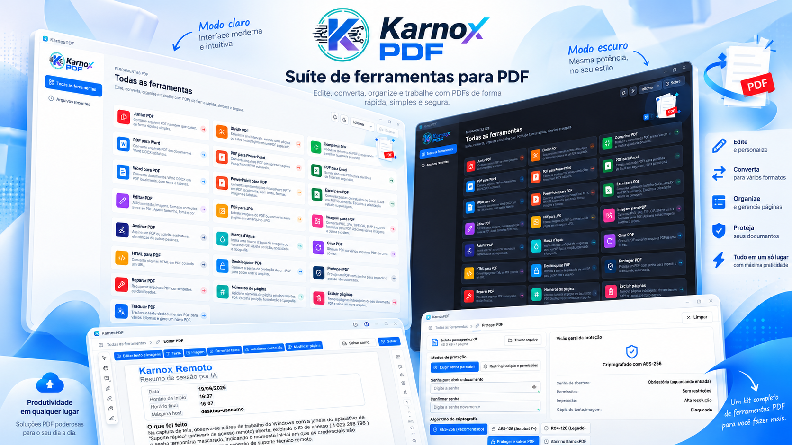
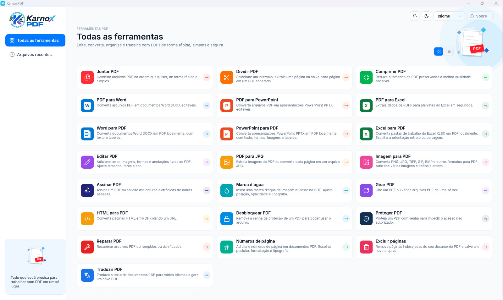

<p align="center">
  
</p>

<p align="center"><b>Suíte de ferramentas para PDF, escrita em Rust.</b><br>
Visualize, edite, converta, organize, proteja e assine PDFs, tudo localmente.</p>

<p align="center">
<b>Português (Brasil)</b> · <a href="README.pt-PT.md">Português (Portugal)</a> · <a href="README.en.md">English</a> · <a href="README.es.md">Español</a> · <a href="README.fr.md">Français</a>
</p>

**Versão 1.0.0** · Licença MIT ou Apache-2.0 · Windows, macOS, Linux, FreeBSD e web (WebAssembly)

## Capturas de tela





## Sumário

- [Instalar](#instalar)
- [Executar](#executar)
- [Recursos](#recursos)
- [Idiomas](#idiomas)
- [Tecnologias](#tecnologias)
- [Desenvolvimento](#desenvolvimento)
- [Licença](#licença)

## Instalar

### Programa pronto (recomendado)

Baixe o instalador da sua plataforma na página de [Releases](https://github.com/euricotecnologia/karnoxpdf/releases):

| Plataforma | Arquivo |
|---|---|
| Windows 10 ou superior (x64, x86, ARM64) | `karnoxpdf-<versão>-windows-<arq>.msi` (instalador) ou `...-portable.zip` (sem instalação) |
| macOS 11 ou superior (Apple silicon e Intel) | `karnoxpdf-<versão>-macos-universal.dmg`: abra e arraste para Aplicativos |
| Linux x86_64 e aarch64 | `.AppImage`, `.deb`, `.rpm` ou `.tar.gz` |
| FreeBSD 14 x86_64 | `.tar.gz` |
| Web | `karnoxpdf-web-<versão>.zip`: site estático, basta hospedar a pasta |

**Nesta versão (1.0.0) a release traz o pacote portátil para Windows x64** (`karnoxpdf-1.0.0-windows-x64-portable.zip`: descompacte e execute `karnoxpdf.exe`). Os pacotes das demais plataformas são gerados pelo fluxo `release.yml` e publicados conforme ficam prontos; até lá, compile a partir do código-fonte (veja abaixo).

No Windows também há um instalador com assistente (`karnoxpdf-1.0.0-windows-x64-setup.exe`),
gerado por `packaging/windows/karnoxpdf-setup.iss` com o Inno Setup.

### Compilar a partir do código-fonte

Requisitos:

- [Rust](https://rustup.rs) 1.90 ou superior.
- **Windows:** ferramentas de compilação MSVC (Visual Studio Build Tools, carga "Desenvolvimento para desktop com C++").
- **Linux:** bibliotecas de desenvolvimento de X11 ou Wayland exigidas pelo egui/wgpu.

```bash
git clone https://github.com/euricotecnologia/karnoxpdf.git
cd karnoxpdf
cargo build --release -p karnoxpdf -p karnoxpdf-cli
```

Os executáveis ficam em `target/release/`: `karnoxpdf` (aplicativo) e `karnoxpdf-cli` (linha de
comando), com extensão `.exe` no Windows.

As fontes japonesas e chinesas são uma entrada opcional de build
(uma pasta de fontes indicada na variável `CRAFT_FONTS_DIR`).
Sem elas o aplicativo compila e funciona; só os rótulos em japonês e chinês aparecem com caixas no
lugar dos caracteres.

```bash
CRAFT_FONTS_DIR=/caminho/das/fontes cargo build --release -p karnoxpdf
```

Para a versão web, veja [packaging/web/README.md](packaging/web/README.md).

## Executar

### Aplicativo

```bash
cargo run --release -p karnoxpdf                  # abre o aplicativo
cargo run --release -p karnoxpdf -- arquivo.pdf   # abre um PDF direto
```

Ou abra o `karnoxpdf` instalado pelo menu Iniciar, Launchpad ou menu de aplicativos. Também é
possível arrastar PDFs para a janela ou usar **Abrir com** no gerenciador de arquivos.

Ao iniciar você vê **Todas as ferramentas**, com um cartão para cada tarefa, e **Arquivos recentes**.
Cada PDF abre numa aba. O idioma e o tema (claro, escuro ou do sistema) são escolhidos em
**Menu > Editar > Preferências…** ou nos atalhos da barra superior, e ficam guardados em `app.ron`.

Atalhos úteis: `Ctrl+K` (⌘K no macOS) abre a paleta de comandos, que acessa qualquer função.

### Linha de comando

```bash
karnoxpdf-cli --help        # ajuda e subcomandos
karnoxpdf-cli tools         # lista as ferramentas de automação
karnoxpdf-cli run --script passos.json --root PASTA   # executa um roteiro JSON
karnoxpdf-cli mcp           # servidor MCP (opcional) por stdio
```

### Registros e diagnóstico

O aplicativo grava `logs/karnoxpdf.log` na pasta de configurações (Windows: `%APPDATA%\KarnoxPDF\data\logs\`).
Variáveis de ambiente como `RUST_LOG` estão em [docs/development.md](docs/development.md).

## Recursos

Todas as funções abaixo funcionam localmente, sem enviar o documento a nenhum serviço. A única
exceção é **Traduzir PDF**, que envia o texto ao serviço online MyMemory. O aplicativo não verifica
atualizações sozinho: **Ajuda > Verificar atualizações** é manual.

### Ferramentas da tela inicial

Juntar PDF · Dividir PDF · Comprimir PDF · PDF para Word · PDF para PowerPoint · PDF para Excel ·
Word para PDF · PowerPoint para PDF · Excel para PDF · Editar PDF · PDF para JPG · Imagem para PDF ·
Assinar PDF · Marca d'água · Girar PDF · HTML para PDF · Desbloquear PDF · Proteger PDF · Reparar PDF ·
Números de página · Excluir páginas · Traduzir PDF.

### Abrir, salvar e segurança do arquivo

- Abre PDFs por menu, arrastar e soltar, linha de comando e **Abrir com** do sistema; lista local de arquivos recentes.
- Abre arquivos danificados reconstruindo a tabela de referências cruzadas, e registra e mostra cada reparo feito (ferramenta **Reparar PDF**).
- Rejeita arquivos corrompidos ou hostis sem travar; uma página defeituosa nunca derruba o programa.
- Abre documentos criptografados com RC4 (40/128 bits), AES-128 e AES-256 (revisões 2 a 6), pede a senha de usuário ou de proprietário e respeita as permissões.
- Salvar incremental (preserva os bytes originais, gravação atômica), Salvar como com reescrita completa e coleta de lixo, objetos compactados em fluxos de objetos, e documentos criptografados são regravados criptografados.
- Desfazer e refazer ilimitados em toda edição (mesmo depois de salvar), edições de vários passos são atômicas, e o menu Editar mostra o nome do passo.
- Salvamento automático periódico, recuperação do trabalho não salvo após falha, aviso ao fechar com alterações e marcador de não salvo nas abas.
- Reverter para a última versão salva; listar as revisões do arquivo e ver uma revisão anterior somente leitura.
- Documentos assinados são sempre salvos de forma incremental, preservando as assinaturas.

### Visualizar

- Abas por documento, miniaturas, marcadores, anexos, camadas (conteúdo opcional), campos de formulário, comentários e assinaturas, cada um em seu painel.
- Páginas simples ou em duas páginas (com capa), rolagem contínua, tela cheia e modo de leitura sem barras de ferramentas.
- Zoom por atalhos, roda do mouse ou gesto de pinça, ao redor do cursor; zoom para porcentagem, tamanho real, ajustar à largura, à altura, à página e ao conteúdo visível; ferramenta de zoom por área.
- Girar a visualização sem alterar o arquivo; ir para página por número ou rótulo lógico (i, ii, 1, 2…); voltar e avançar entre visualizações.
- Ferramenta Mão, rolagem automática, seleção e cópia de texto na ordem de leitura, selecionar todo o texto da página e instantâneo (copia uma região como imagem).
- Localizar texto no documento (palavras inteiras, diferenciar maiúsculas), lista de resultados, próximo e anterior, e janela de busca avançada.
- Seguir links e destinos; mostrar texto de comentários ao passar o mouse.
- Renderização de texto, vetores e imagens (JPEG, JPEG 2000, JBIG2, CCITT), fontes CID e CJK, fontes Type 3, degradês, padrões, modos de mesclagem, máscaras suaves e grupos de transparência; renderização em blocos para zoom profundo.
- Temas claro, escuro e do sistema; idiomas português do Brasil, português de Portugal, inglês, espanhol e francês.
- Atalhos de teclado por plataforma, paleta de comandos e leitor de tela (AccessKit).
- Versão web do mesmo aplicativo, em WebAssembly.

### Organizar páginas e documento

- Grade de miniaturas para organizar; selecionar por clique, Ctrl/⌘ e Shift, por intervalo, pares/ímpares e retrato/paisagem.
- Girar páginas (por intervalo, pares/ímpares e orientação), excluir, mover, reordenar arrastando, duplicar, copiar, recortar e colar páginas.
- Inserir páginas em branco, inserir de outro arquivo e substituir páginas por páginas de outro arquivo.
- Extrair páginas para um novo documento ou para arquivos separados, com opção de excluí-las depois.
- Dividir a cada N páginas, antes de páginas escolhidas, por tamanho de arquivo ou por marcadores de nível superior.
- Juntar arquivos escolhendo as páginas de cada um; cria um marcador por arquivo, mantém anexos, campos de formulário interativos, camadas e links, e guarda fontes e imagens idênticas uma única vez.
- Cortar páginas arrastando um retângulo e definir caixas de página (corte, aparo, sangria, arte).
- Marcadores: adicionar, renomear, reordenar, aninhar, excluir, expandir e recolher, e definir o destino.
- Rótulos de página (estilo, prefixo, início) e números de página com posição, formato e tipografia.
- Propriedades do documento: título, autor, assunto, palavras-chave, idioma, direção de leitura, lista de fontes (tipo e incorporação) e visualização inicial (layout, ampliação, painéis, janela).

### Editar conteúdo

- Adicionar caixas de texto, imagens, formas e anotações livres; tudo continua editável (mover, redimensionar, girar, espelhar, recortar, substituir imagem mantendo posição e tamanho, salvar imagem em arquivo).
- Formatar texto: fonte, tamanho, cor, negrito, itálico, sublinhado, alinhamento (esquerda, centro, direita, justificado), espaçamento de linhas, de parágrafos e de caracteres, e escala horizontal; painel de formatação.
- Editar texto existente no lugar, com detecção de parágrafos e blocos, reflow dentro da caixa do parágrafo e reaproveitamento de fontes incorporadas (ou substituição com aviso).
- Selecionar, mover, redimensionar, recolorir e excluir caminhos vetoriais.
- Cabeçalho e rodapé (intervalos: todas, faixa, pares, ímpares; marcadores de número de página e data), atualizar ou remover.
- Marca d'água de texto, imagem ou página de PDF, com rotação, opacidade, escala, posição e visibilidade na tela e na impressão; atualizar ou remover.
- Plano de fundo (cor ou arquivo), atualizar ou remover.
- Numeração Bates.
- Links: criar links web e de página, criar links a partir de URLs no texto, propriedades e aparência, remover todos.
- Ações: ir para visualização de página, abrir link web e mostrar/ocultar campo.

### Converter e criar

- **Para PDF:** Word (.docx), PowerPoint (.pptx) e Excel (.xlsx), convertidos localmente, sem instalar outro programa; HTML (colando uma URL); imagens (JPEG, PNG, TIFF de várias páginas, GIF, BMP, JPEG 2000); texto simples; área de transferência; PDF em branco.
- **Word para PDF:** parágrafos, formatação, tabelas e formas simples.
- **PowerPoint para PDF:** uma página por slide, com layouts, mestres, temas, textos, marcadores, formas, imagens e tabelas.
- **Excel para PDF:** imprime todas as planilhas visíveis como o Excel imprime (papel, margens, escala, quebras de página, títulos de impressão, cabeçalho e rodapé), com formatos de número, preenchimentos, bordas e alinhamento; escolha de retrato ou paisagem.
- **Exportar PDF para:** Word (.docx), PowerPoint (.pptx), Excel (.xlsx, com detecção de tabelas), HTML, RTF, texto simples (ordem de leitura com colunas, RTL e CJK), PNG, JPEG e TIFF; exportar todas as imagens incorporadas.
- **PDF para JPG:** área própria com escolha de resolução, qualidade e intervalo de páginas, exportando para uma pasta.
- Opções de resolução (incorporada, 72 ou personalizada) e compressão ao converter imagens.

### Comentários e revisão

- Nota adesiva, texto livre (máquina de escrever), caixa de texto com texto formatado e texto de chamada.
- Realçar, sublinhar, tachar e ondular texto; realce de área; propostas de inserção e substituição de texto.
- Desenho livre com borracha, linha, seta, linhas conectadas, retângulo, oval, polígono e nuvem, com os dez estilos de extremidade de linha e bordas tracejadas ou em nuvem.
- Carimbos padrão, de negócios, dinâmicos (nome e data), "Assine aqui" e personalizados a partir de imagens ou páginas de PDF; anexar arquivo como comentário.
- Responder a comentários em conversas, definir estado de revisão (aceito, rejeitado, cancelado, concluído), marcar com visto, bloquear, histórico de revisão.
- Painel de comentários com busca, filtro (tipo, autor, estado, cor, visto) e ordenação (página, autor, data, tipo, cor); ocultar ou mostrar todos.
- Propriedades (aparência, autor, assunto), barra de propriedades, tornar as propriedades atuais o padrão da ferramenta e nome do autor a partir das preferências.
- Importar e exportar comentários em FDF e XFDF, gerar um resumo dos comentários como novo PDF e achatar comentários no conteúdo da página.
- **Medição:** distância, perímetro e área, escala calibrada por visualização, encaixe em caminhos, extremidades, pontos médios e interseções, painel de informações e exportação CSV.

### Formulários e JavaScript

- Preencher campos de texto, caixas de seleção, botões de opção, listas e menus suspensos, com seletor de data; alternar caixas e rádios; Tab entre campos; realçar campos existentes e destacar os obrigatórios.
- Detecção automática de campos; limpar ou redefinir o formulário; achatar campos de formulário.
- Preencher e Assinar: adicionar texto em formulários planos, marcas (visto, cruz, ponto, linha), data de hoje, assinatura e iniciais digitadas, desenhadas ou de imagem, com achatamento ao salvar.
- **Criar formulários (modo Preparar):** campos de texto, caixas de seleção, botões de opção, listas, menus suspensos, data, imagem, botão e assinatura digital; mover, redimensionar, duplicar entre páginas, alinhar, centralizar, distribuir, igualar tamanhos, renomear e bloquear; nomear campos a partir de rótulos próximos; modo de visualização para testar.
- Propriedades do campo: geral (nome, dica, visibilidade, somente leitura, obrigatório), aparência (borda, preenchimento, fonte), posição, opções por tipo, ações por gatilho, formato, validação e cálculo; ordem de tabulação (linha, coluna, estrutura, manual) e ordem de cálculo.
- Formatos e validações no padrão Acrobat: números e moeda, porcentagem, data e hora, formatos especiais (CEP (ZIP), telefone, SSN, máscara livre), validação de intervalo, soma, produto, média, mínimo, máximo e notação simplificada de campos, na ordem de eventos do Acrobat.
- Motor JavaScript (sandbox) com subconjunto do modelo de objetos do Acrobat: scripts de teclado, validação, cálculo e formato, scripts de documento, botões de ação, console e chave para ativar ou desativar.
- Troca de dados: importar e exportar FDF e XFDF, dados de formulário em XML, CSV e texto separado por tabulações, e mesclar arquivos de dados numa planilha.
- Formulários XFA: leitura do modelo, exibição e preenchimento, importação e exportação de dados XML.

### Proteger

- Proteger com senha para abrir, com medidor de força da senha.
- Restringir edição e impressão com senha de permissões (impressão, alterações, cópia, acessibilidade).
- Escolher a compatibilidade da criptografia: RC4 40/128 bits, AES-128 ou AES-256; criptografar tudo exceto metadados.
- Remover a segurança (Desbloquear PDF) e ver as propriedades de segurança (método, qual senha abriu, cada permissão).
- **Redação:** marcar texto, áreas, imagens e páginas inteiras; localizar texto e redigir; padrões prontos (telefone, e-mail, cartão, SSN, datas); cor de preenchimento e texto de sobreposição; ao aplicar, remove glifos do texto, pixels de imagens, caminhos vetoriais, conteúdo de XObjects, anotações e campos sob a marca, e texto em etiquetas e textos alternativos; verifica que não sobrou resíduo.
- Remover informações ocultas (categorias selecionáveis) e Sanitizar documento.

### Assinaturas digitais

- Assinar com certificado PKCS #12 (.p12/.pfx) ou com identidades do Keychain do macOS; criar identidade digital autoassinada.
- Assinaturas visíveis (desenhando um retângulo), invisíveis ou em campo existente, com aparência configurável (texto, imagem, nome), motivo, local e contato.
- PAdES/CAdES B-B (SHA-256/384/512, sem SHA-1 em assinaturas novas), carimbo de tempo, validação de longo prazo com revogação (OCSP e CRL) e assinatura de documento com carimbo de tempo (RFC 3161).
- Certificar documento (DocMDP) com escolha das alterações permitidas.
- Validar todas as assinaturas, inclusive ao abrir o documento; estado (válida, desconhecida, inválida); painel de assinaturas com árvore por revisão; barra de mensagem para documentos assinados ou certificados.
- Lista das alterações feitas depois da assinatura, visualizar a versão assinada, visualizador e exportação de certificado, armazenamento e importação de certificados confiáveis, e escolha do momento de verificação.

### OCR

- Reconhecer texto na página atual, em um intervalo, no arquivo inteiro ou em vários arquivos, ignorando páginas que já têm texto.
- Saída em imagem pesquisável: camada de texto invisível, com a imagem original intacta (modo exato).
- Seleção do idioma do documento (alfabeto latino).

### Otimizar e padrões

- **Reduzir tamanho do arquivo** com predefinições de qualidade, e **Otimizador de PDF** avançado.
- Reduzir a resolução de imagens coloridas, cinza e monocromáticas e recomprimir (JPEG, JPEG 2000, Flate), somente quando fica menor.
- Compactar a estrutura em fluxos de objetos, recodificar fluxos em Flate (substituindo LZW), mesclar recursos e achatar camadas.
- Descartar: JavaScript, comentários, formulários e multimídia, informações do documento e metadados, etiquetas, marcadores, miniaturas, anexos, imagens alternativas, configurações de impressão e dados privados de aplicativo; remover links, marcadores e destinos inválidos; achatar campos de formulário.
- Auditar o uso de espaço.
- Verificar conformidade com PDF/A (1 a 4), salvar como PDF/A (1b, 2b, 3b, 4), painel de padrões que mostra a conformidade declarada e escolha de intenções de saída.

### Imprimir

- Caixa de diálogo de impressão com visualização prévia, escolha de impressora e propriedades (CUPS), cópias e agrupamento.
- Todas as páginas, a atual ou um intervalo (inclusive por rótulo), pares ou ímpares e ordem inversa.
- Ajustar, tamanho real, reduzir páginas grandes e escala personalizada; orientação automática; escala de cinza.
- Várias páginas por folha, livreto, pôster em blocos com sobreposição e marcas de corte, impressão frente e verso e imposição com corte e empilhamento.
- Imprimir o documento, comentários, carimbos ou apenas campos de formulário, e gerar um PDF pronto para impressão.

### Acessibilidade

- Verificador de acessibilidade completo, com as 32 regras (etiquetas, texto alternativo, ordem de leitura, tabelas, listas, títulos, idioma, contraste, formulários, marcadores e outras), relatório, e ações Corrigir, Ignorar, Explicar e Verificar novamente.
- Definir o idioma do documento, texto alternativo figura por figura (com opção decorativa) e mostrar o título do documento na janela.

### Comparar

- Comparar dois arquivos: diferenças de texto e visuais, e relatório-resumo em PDF.

### Automação e integração

- **Linha de comando:** inspecionar, renderizar e extrair texto; editar, juntar, extrair e dividir; `run` chama qualquer ferramenta de automação ou um roteiro JSON; processamento em lote de arquivos e pastas.
- **Servidor MCP** opcional por stdio, com recursos de texto e imagens de página, para uso por agentes de IA.
- Mais de 120 ferramentas de automação com esquemas JSON, que cobrem todos os comandos, com acesso a arquivos confinado a uma pasta raiz.
- **Assistente de Ações:** criar, editar e executar ações guiadas sobre arquivos, com ações prontas (otimizar documentos digitalizados, preparar para distribuição).
- Canal de controle da interface (inspecionar, clicar, digitar, teclas, comandos e capturas de tela), desativado por padrão.
- Um único registro de comandos alimenta menus, atalhos, paleta e automação; comandos desativados explicam o motivo.
- Preferências geradas a partir de um esquema (idioma, exibição de páginas, JavaScript).

## Idiomas

A interface do KarnoxPDF está disponível em:

| Idioma | Código |
|---|---|
| Português do Brasil | `pt-br` |
| Português de Portugal | `pt-pt` |
| Inglês | `en` |
| Espanhol | `es` |
| Francês | `fr` |

**Como o idioma é escolhido**

- **Automático (padrão):** segue o idioma do sistema. No Linux e FreeBSD lê `LC_ALL`, `LC_MESSAGES` ou `LANG`; no macOS, a lista de idiomas preferidos; no Windows, os idiomas de exibição em ordem de preferência.
- `pt_BR` usa português do Brasil, `pt_PT` usa português de Portugal, e os demais locais de português usam o do Brasil. Variantes regionais do francês e do espanhol usam o catálogo do idioma.
- Se o idioma do sistema não tiver catálogo, a interface aparece em inglês.
- Você pode trocar a qualquer momento em **Menu > Editar > Preferências… > Geral > Idioma da interface**, ou pelo menu de idioma da barra superior. A troca vale na hora e fica guardada em `app.ron`.

Comandos, conteúdo e nomes de arquivos dos documentos não são traduzidos. Mensagens de erro vindas do sistema operacional aparecem como o sistema as entrega, dentro de uma moldura traduzida. Veja [docs/localization.md](docs/localization.md).

## Tecnologias

| Camada | Tecnologia |
|---|---|
| Linguagem | Rust (edição 2024, versão mínima 1.90), `unsafe` proibido, sem JavaScript/TypeScript escrito à mão |
| Interface | egui/eframe com wgpu (Direct3D 12 no Windows, Metal, Vulkan e OpenGL), leitor de tela via AccessKit |
| Web | WebAssembly com `wasm-bindgen` e Trunk |
| Núcleo PDF próprio | `cos` (leitor tolerante, gravação incremental e completa), `filters`, `crypt` |
| Renderização | `hayro`, em cópias corrigidas na pasta [`vendor/`](vendor/README.md) |
| Assinaturas | RustCrypto (X.509, CMS, PKCS #12, ECDSA, RSA) e `aws-lc-rs` |
| JavaScript dos formulários | `boa_engine`, em sandbox |
| OCR | `ocrs` com `rten` |
| Imagens e fontes | `image`, `png`, `tiff`, `skrifa` |
| Qualidade | `cargo-deny` (só licenças permissivas), fuzzing, testes de interface com kittest, GitHub Actions |
| Empacotamento | MSI (WiX) e Inno Setup no Windows, DMG no macOS, AppImage/deb/rpm no Linux, FreeBSD e web |

O código está dividido em 29 crates em [`crates/`](crates/), três aplicativos em [`apps/`](apps/)
(`karnoxpdf`, `karnoxpdf-cli`, `karnoxpdf-web`) e a ferramenta de build em [`xtask/`](xtask/).

## Desenvolvimento

```bash
cargo fmt --check
cargo clippy --workspace -- -D warnings
cargo test --workspace
cargo xtask assets      # confere origem e licença de todo recurso (ícone, imagem, fonte)
cargo xtask parity      # progresso em relação à lista de recursos do Acrobat Pro
```

Leia [AGENTS.md](AGENTS.md) antes de contribuir: regras para recursos
visuais, desenvolvimento *clean-room* (nada é copiado ou desmontado de outro produto) e "nunca
entrar em pânico" diante de arquivos hostis. Mais detalhes em [docs/development.md](docs/development.md),
[docs/releasing.md](docs/releasing.md) e [ROADMAP.md](ROADMAP.md).

## Licença

Licença dupla, à sua escolha: [MIT](LICENSE-MIT) ou [Apache-2.0](LICENSE-APACHE). Os créditos e
licenças de componentes de terceiros estão em [THIRD_PARTY_NOTICES.md](THIRD_PARTY_NOTICES.md) e
[ATTRIBUTION.md](ATTRIBUTION.md).

KarnoxPDF não é um produto da Adobe.
