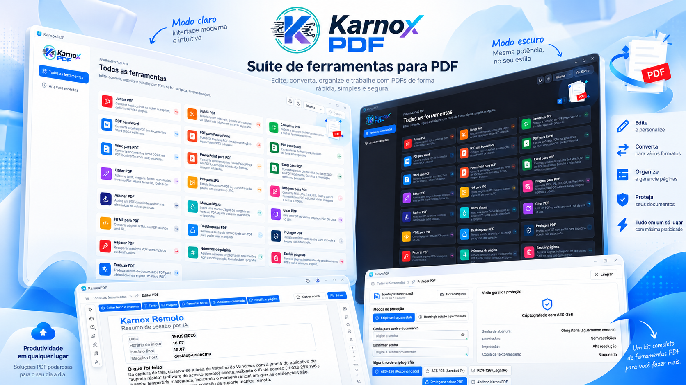
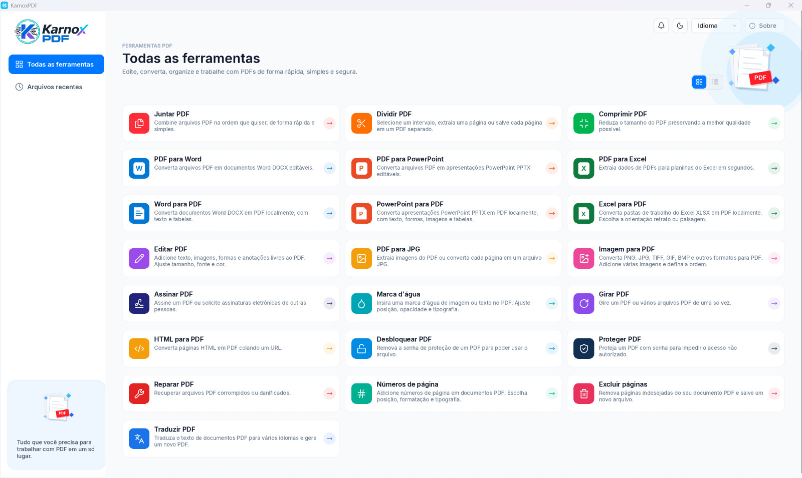

<p align="center">
  
</p>

<p align="center"><b>Um conjunto de ferramentas para PDF, escrito em Rust.</b><br>
Visualize, edite, converta, organize, proteja e assine PDF, tudo localmente.</p>

<p align="center">
<a href="README.md">Português (Brasil)</a> · <b>Português (Portugal)</b> · <a href="README.en.md">English</a> · <a href="README.es.md">Español</a> · <a href="README.fr.md">Français</a>
</p>

**Versão 1.0.0** · Licença MIT ou Apache-2.0 · Windows, macOS, Linux, FreeBSD e web (WebAssembly)

## Capturas de ecrã





## Índice

- [Instalar](#instalar)
- [Executar](#executar)
- [Funcionalidades](#funcionalidades)
- [Idiomas](#idiomas)
- [Tecnologias](#tecnologias)
- [Desenvolvimento](#desenvolvimento)
- [Licença](#licença)

## Instalar

### Programa pronto (recomendado)

Descarregue o instalador da sua plataforma na página de [Releases](https://github.com/euricotecnologia/karnoxpdf/releases):

| Plataforma | Ficheiro |
|---|---|
| Windows 10 ou superior (x64, x86, ARM64) | `karnoxpdf-<versão>-windows-<arq>.msi` (instalador) ou `...-portable.zip` (sem instalação) |
| macOS 11 ou superior (Apple silicon e Intel) | `karnoxpdf-<versão>-macos-universal.dmg`: abra-o e arraste a aplicação para Aplicações |
| Linux x86_64 e aarch64 | `.AppImage`, `.deb`, `.rpm` ou `.tar.gz` |
| FreeBSD 14 x86_64 | `.tar.gz` |
| Web | `karnoxpdf-web-<versão>.zip`: site estático, basta alojar a pasta |

**Nesta versão (1.0.0) a release inclui o pacote portátil para Windows x64** (`karnoxpdf-1.0.0-windows-x64-portable.zip`: descompacte e execute `karnoxpdf.exe`). Os pacotes das restantes plataformas são gerados pelo fluxo `release.yml` e publicados à medida que ficam prontos; até lá, compile a partir do código-fonte (veja abaixo).

No Windows também existe um instalador com assistente (`karnoxpdf-1.0.0-windows-x64-setup.exe`),
gerado a partir de `packaging/windows/karnoxpdf-setup.iss` com o Inno Setup.

### Compilar a partir do código-fonte

Requisitos:

- [Rust](https://rustup.rs) 1.90 ou superior.
- **Windows:** ferramentas de compilação MSVC (Visual Studio Build Tools, carga de trabalho «Desenvolvimento de ambiente de trabalho com C++»).
- **Linux:** bibliotecas de desenvolvimento de X11 ou Wayland exigidas pelo egui/wgpu.

```bash
git clone https://github.com/euricotecnologia/karnoxpdf.git
cd karnoxpdf
cargo build --release -p karnoxpdf -p karnoxpdf-cli
```

Os executáveis ficam em `target/release/`: `karnoxpdf` (a aplicação) e `karnoxpdf-cli` (a linha de
comandos), com a extensão `.exe` no Windows.

Os tipos de letra japoneses e chineses são uma entrada opcional de compilação (uma pasta de tipos
de letra indicada na variável `CRAFT_FONTS_DIR`). Sem eles a aplicação compila e funciona; só os
rótulos em japonês e chinês aparecem com quadrados no lugar dos carateres.

```bash
CRAFT_FONTS_DIR=/caminho/dos/tipos-de-letra cargo build --release -p karnoxpdf
```

Para a versão web, consulte [packaging/web/README.md](packaging/web/README.md).

## Executar

### Aplicação

```bash
cargo run --release -p karnoxpdf                  # abre a aplicação
cargo run --release -p karnoxpdf -- ficheiro.pdf  # abre um PDF diretamente
```

Ou abra o `karnoxpdf` instalado a partir do menu Iniciar, do Launchpad ou do menu de aplicações.
Também pode arrastar PDF para a janela ou usar **Abrir com** no gestor de ficheiros.

Ao iniciar, vê **Todas as ferramentas**, com um cartão para cada tarefa, e **Ficheiros recentes**.
Cada PDF abre num separador. O idioma e o tema (claro, escuro ou do sistema) escolhem-se em
**Menu > Editar > Preferências…** ou nos atalhos da barra superior, e ficam guardados em `app.ron`.

Atalho útil: `Ctrl+K` (⌘K no macOS) abre a paleta de comandos, que dá acesso a qualquer função.

### Linha de comandos

```bash
karnoxpdf-cli --help        # ajuda e subcomandos
karnoxpdf-cli tools         # lista as ferramentas de automatização
karnoxpdf-cli run --script passos.json --root PASTA   # executa um guião JSON
karnoxpdf-cli mcp           # servidor MCP (opcional) por stdio
```

### Registos e diagnóstico

A aplicação grava `logs/karnoxpdf.log` na pasta de definições (Windows: `%APPDATA%\KarnoxPDF\data\logs\`).
As variáveis de ambiente como `RUST_LOG` estão descritas em [docs/development.md](docs/development.md).

## Funcionalidades

Todas as funções abaixo funcionam localmente, sem enviar o documento a nenhum serviço. A única
exceção é **Traduzir PDF**, que envia o texto para o serviço em linha MyMemory. A aplicação não
procura atualizações sozinha: **Ajuda > Verificar atualizações** é manual.

### Ferramentas do ecrã inicial

Juntar PDF · Dividir PDF · Comprimir PDF · PDF para Word · PDF para PowerPoint · PDF para Excel ·
Word para PDF · PowerPoint para PDF · Excel para PDF · Editar PDF · PDF para JPG · Imagem para PDF ·
Assinar PDF · Marca de água · Rodar PDF · HTML para PDF · Desbloquear PDF · Proteger PDF · Reparar PDF ·
Números de página · Eliminar páginas · Traduzir PDF.

### Abrir, guardar e segurança do ficheiro

- Abre PDF pelo menu, por arrastar e largar, pela linha de comandos e com **Abrir com** do sistema; lista local de ficheiros recentes.
- Abre ficheiros danificados reconstruindo a tabela de referências cruzadas, e regista e mostra cada reparação feita (ferramenta **Reparar PDF**).
- Rejeita ficheiros corrompidos ou hostis sem falhar; uma página defeituosa nunca deita abaixo o programa.
- Abre documentos cifrados com RC4 (40/128 bits), AES-128 e AES-256 (revisões 2 a 6), pede a palavra-passe de utilizador ou de proprietário e respeita as permissões.
- Gravação incremental (preserva os bytes originais, escrita atómica), Guardar como com reescrita completa e recolha de lixo, objetos compactados em fluxos de objetos, e os documentos cifrados são regravados cifrados.
- Anular e refazer ilimitados em cada edição (mesmo depois de guardar), as edições de vários passos são atómicas, e o menu Editar mostra o nome do passo.
- Gravação automática periódica, recuperação do trabalho não guardado após uma falha, aviso ao fechar com alterações e marcador de não guardado nos separadores.
- Reverter para a última versão guardada; listar as revisões do ficheiro e ver uma revisão anterior só de leitura.
- Os documentos assinados são sempre guardados de forma incremental, preservando as assinaturas.

### Visualizar

- Separadores por documento, miniaturas, marcadores, anexos, camadas (conteúdo opcional), campos de formulário, comentários e assinaturas, cada um no seu painel.
- Página única ou duas páginas (com capa), deslocamento contínuo, ecrã completo e modo de leitura sem barras de ferramentas.
- Zoom por atalhos, roda do rato ou gesto de pinça, em redor do cursor; zoom para uma percentagem, tamanho real, ajustar à largura, à altura, à página e ao conteúdo visível; ferramenta de zoom por área.
- Rodar a vista sem alterar o ficheiro; ir para uma página por número ou etiqueta lógica (i, ii, 1, 2…); vista anterior e seguinte.
- Ferramenta Mão, deslocamento automático, seleção e cópia de texto pela ordem de leitura, selecionar todo o texto da página e instantâneo (copia uma região como imagem).
- Localizar texto no documento (palavras inteiras, distinguir maiúsculas), lista de resultados, seguinte e anterior, e janela de pesquisa avançada.
- Seguir ligações e destinos; mostrar o texto dos comentários ao passar o rato.
- Composição de texto, vetores e imagens (JPEG, JPEG 2000, JBIG2, CCITT), tipos de letra CID e CJK, tipos de letra Type 3, gradientes, padrões, modos de mistura, máscaras suaves e grupos de transparência; composição por mosaicos para zoom profundo.
- Temas claro, escuro e do sistema; idiomas português do Brasil, português de Portugal, inglês, espanhol e francês.
- Atalhos de teclado por plataforma, paleta de comandos e suporte a leitores de ecrã (AccessKit).
- Versão web da mesma aplicação, em WebAssembly.

### Organizar páginas e documento

- Grelha de miniaturas para organizar; selecionar por clique, Ctrl/⌘ e Shift, por intervalo, páginas pares/ímpares e vertical/horizontal.
- Rodar páginas (por intervalo, pares/ímpares e orientação), eliminar, mover, reordenar arrastando, duplicar, copiar, cortar e colar páginas.
- Inserir páginas em branco, inserir de outro ficheiro e substituir páginas por páginas de outro ficheiro.
- Extrair páginas para um novo documento ou para ficheiros separados, com a opção de as eliminar depois.
- Dividir a cada N páginas, antes de páginas escolhidas, por tamanho de ficheiro ou por marcadores de nível superior.
- Juntar ficheiros escolhendo as páginas de cada um; cria um marcador por ficheiro, mantém anexos, campos de formulário interativos, camadas e ligações, e guarda uma só vez os tipos de letra e as imagens idênticos.
- Recortar páginas arrastando um retângulo e definir caixas de página (recorte, aparo, sangria, arte).
- Marcadores: adicionar, mudar o nome, reordenar, aninhar, eliminar, expandir e recolher, e definir o destino.
- Etiquetas de página (estilo, prefixo, início) e números de página com posição, formato e tipografia.
- Propriedades do documento: título, autor, assunto, palavras-chave, idioma, direção de leitura, lista de tipos de letra (tipo e incorporação) e vista inicial (disposição, ampliação, painéis, janela).

### Editar conteúdo

- Adicionar caixas de texto, imagens, formas e anotações livres; tudo continua editável (mover, redimensionar, rodar, espelhar, recortar, substituir uma imagem mantendo posição e tamanho, guardar uma imagem num ficheiro).
- Formatar texto: tipo de letra, tamanho, cor, negrito, itálico, sublinhado, alinhamento (esquerda, centro, direita, justificado), espaçamento de linhas, de parágrafos e de carateres, e escala horizontal; painel de formatação.
- Editar o texto existente no local, com deteção de parágrafos e blocos, reflow dentro da caixa do parágrafo e reaproveitamento de tipos de letra incorporados (ou substituição com aviso).
- Selecionar, mover, redimensionar, recolorir e eliminar caminhos vetoriais.
- Cabeçalho e rodapé (intervalos: todas, faixa, pares, ímpares; marcadores de número de página e data), atualizar ou remover.
- Marca de água de texto, imagem ou página de PDF, com rotação, opacidade, escala, posição e visibilidade no ecrã e na impressão; atualizar ou remover.
- Fundo (cor ou ficheiro), atualizar ou remover.
- Numeração Bates.
- Ligações: criar ligações web e de página, criar ligações a partir de URL no texto, propriedades e aspeto, remover todas.
- Ações: ir para uma vista de página, abrir uma ligação web e mostrar/ocultar um campo.

### Converter e criar

- **Para PDF:** Word (.docx), PowerPoint (.pptx) e Excel (.xlsx), convertidos localmente, sem instalar outro programa; HTML (colando um URL); imagens (JPEG, PNG, TIFF de várias páginas, GIF, BMP, JPEG 2000); texto simples; área de transferência; PDF em branco.
- **Word para PDF:** parágrafos, formatação, tabelas e formas simples.
- **PowerPoint para PDF:** uma página por diapositivo, com esquemas, modelos, temas, textos, marcadores, formas, imagens e tabelas.
- **Excel para PDF:** imprime todas as folhas visíveis como o Excel as imprime (papel, margens, escala, quebras de página, títulos de impressão, cabeçalho e rodapé), com formatos de número, preenchimentos, limites e alinhamento; escolha de vertical ou horizontal.
- **Exportar PDF para:** Word (.docx), PowerPoint (.pptx), Excel (.xlsx, com deteção de tabelas), HTML, RTF, texto simples (ordem de leitura com colunas, RTL e CJK), PNG, JPEG e TIFF; exportar todas as imagens incorporadas.
- **PDF para JPG:** área própria com escolha de resolução, qualidade e intervalo de páginas, exportando para uma pasta.
- Opções de resolução (incorporada, 72 ou personalizada) e de compressão ao converter imagens.

### Comentários e revisão

- Nota autoadesiva, texto livre (máquina de escrever), caixa de texto com texto formatado e texto de chamada.
- Realçar, sublinhar, rasurar e sublinhar a ondulado o texto; realce de área; propostas de inserção e de substituição de texto.
- Desenho livre com borracha, linha, seta, linhas ligadas, retângulo, oval, polígono e nuvem, com os dez estilos de extremidade de linha e limites tracejados ou em nuvem.
- Carimbos padrão, de negócios, dinâmicos (nome e data), «Assine aqui» e personalizados a partir de imagens ou páginas de PDF; anexar um ficheiro como comentário.
- Responder a comentários em conversas, definir o estado de revisão (aceite, rejeitado, cancelado, concluído), marcar com visto, bloquear, histórico de revisão.
- Painel de comentários com pesquisa, filtro (tipo, autor, estado, cor, visto) e ordenação (página, autor, data, tipo, cor); ocultar ou mostrar todos.
- Propriedades (aspeto, autor, assunto), barra de propriedades, tornar as propriedades atuais as predefinidas da ferramenta e nome do autor a partir das preferências.
- Importar e exportar comentários em FDF e XFDF, gerar um resumo dos comentários como novo PDF e nivelar os comentários no conteúdo da página.
- **Medição:** distância, perímetro e área, escala calibrada por vista, ajuste a caminhos, extremidades, pontos médios e interseções, painel de informações e exportação CSV.

### Formulários e JavaScript

- Preencher campos de texto, caixas de seleção, botões de opção, listas e menus pendentes, com seletor de data; alternar caixas e botões de opção; Tab entre campos; realçar os campos existentes e os obrigatórios.
- Deteção automática de campos; limpar ou repor o formulário; nivelar os campos de formulário.
- Preencher e Assinar: adicionar texto em formulários planos, marcas (visto, cruz, ponto, linha), a data de hoje, assinatura e iniciais escritas, desenhadas ou de imagem, com nivelamento ao guardar.
- **Criar formulários (modo Preparar):** campos de texto, caixas de seleção, botões de opção, listas, menus pendentes, data, imagem, botão e assinatura digital; mover, redimensionar, duplicar entre páginas, alinhar, centrar, distribuir, igualar tamanhos, mudar o nome e bloquear; nomear campos a partir de rótulos próximos; modo de pré-visualização para testar.
- Propriedades do campo: geral (nome, dica, visibilidade, só de leitura, obrigatório), aspeto (limite, preenchimento, tipo de letra), posição, opções por tipo, ações por acionador, formato, validação e cálculo; ordem de tabulação (linha, coluna, estrutura, manual) e ordem de cálculo.
- Formatos e validações no padrão do Acrobat: números e moeda, percentagem, data e hora, formatos especiais (código postal, telefone, SSN, máscara livre), validação de intervalo, soma, produto, média, mínimo, máximo e notação simplificada de campos, na ordem de eventos do Acrobat.
- Motor JavaScript (em ambiente isolado) com um subconjunto do modelo de objetos do Acrobat: scripts de teclado, validação, cálculo e formato, scripts de documento, botões de ação, consola e interruptor para ativar ou desativar.
- Troca de dados: importar e exportar FDF e XFDF, dados de formulário em XML, CSV e texto separado por tabulações, e juntar ficheiros de dados numa folha de cálculo.
- Formulários XFA: leitura do modelo, apresentação e preenchimento, importação e exportação de dados XML.

### Proteger

- Proteger com palavra-passe para abrir, com medidor de força da palavra-passe.
- Restringir a edição e a impressão com uma palavra-passe de permissões (impressão, alterações, cópia, acessibilidade).
- Escolher a compatibilidade da cifragem: RC4 40/128 bits, AES-128 ou AES-256; cifrar tudo exceto os metadados.
- Remover a segurança (Desbloquear PDF) e ver as propriedades de segurança (método, que palavra-passe o abriu, cada permissão).
- **Redação:** marcar texto, áreas, imagens e páginas inteiras; localizar texto e redigir; padrões prontos (telefone, e-mail, cartão, SSN, datas); cor de preenchimento e texto de sobreposição; ao aplicar, remove glifos de texto, píxeis de imagens, caminhos vetoriais, conteúdo de XObjects, anotações e campos sob a marca, e texto em etiquetas e textos alternativos; verifica que não ficou nenhum resíduo.
- Remover informação oculta (categorias selecionáveis) e Higienizar o documento.

### Assinaturas digitais

- Assinar com um certificado PKCS #12 (.p12/.pfx) ou com identidades do Porta-chaves do macOS; criar uma identidade digital autoassinada.
- Assinaturas visíveis (desenhando um retângulo), invisíveis ou num campo existente, com aspeto configurável (texto, imagem, nome), motivo, local e contacto.
- PAdES/CAdES B-B (SHA-256/384/512, sem SHA-1 em assinaturas novas), carimbo de data/hora, validação de longo prazo com revogação (OCSP e CRL) e assinatura de documento com carimbo de data/hora (RFC 3161).
- Certificar um documento (DocMDP) com escolha das alterações permitidas.
- Validar todas as assinaturas, inclusive ao abrir o documento; estado (válida, desconhecida, inválida); painel de assinaturas com árvore por revisão; barra de mensagens para documentos assinados ou certificados.
- Lista das alterações feitas depois da assinatura, ver a versão assinada, visualizador e exportação de certificados, repositório e importação de certificados de confiança, e escolha do momento de verificação.

### OCR

- Reconhecer texto na página atual, num intervalo, no ficheiro inteiro ou em vários ficheiros, ignorando as páginas que já têm texto.
- Saída em imagem pesquisável: uma camada de texto invisível, com a imagem original intacta (modo exato).
- Seleção do idioma do documento (alfabeto latino).

### Otimizar e normas

- **Reduzir o tamanho do ficheiro** com predefinições de qualidade, e **Otimizador de PDF** avançado.
- Reduzir a resolução de imagens a cores, em tons de cinzento e monocromáticas e voltar a comprimir (JPEG, JPEG 2000, Flate), só quando fica menor.
- Compactar a estrutura em fluxos de objetos, recodificar fluxos em Flate (substituindo LZW), juntar recursos e nivelar camadas.
- Descartar: JavaScript, comentários, formulários e multimédia, informações do documento e metadados, etiquetas, marcadores, miniaturas, anexos, imagens alternativas, definições de impressão e dados privados de aplicações; remover ligações, marcadores e destinos inválidos; nivelar campos de formulário.
- Auditar a utilização do espaço.
- Verificar a conformidade com PDF/A (1 a 4), guardar como PDF/A (1b, 2b, 3b, 4), painel de normas que mostra a conformidade declarada e escolha de intenções de saída.

### Imprimir

- Caixa de diálogo de impressão com pré-visualização, escolha da impressora e propriedades (CUPS), cópias e agrupamento.
- Todas as páginas, a atual ou um intervalo (inclusive por etiqueta), pares ou ímpares e ordem inversa.
- Ajustar, tamanho real, reduzir páginas grandes e escala personalizada; orientação automática; escala de cinzentos.
- Várias páginas por folha, livro, póster em mosaicos com sobreposição e marcas de corte, impressão em frente e verso e imposição com corte e empilhamento.
- Imprimir o documento, os comentários, os carimbos ou apenas os campos de formulário, e gerar um PDF pronto para impressão.

### Acessibilidade

- Verificador de acessibilidade completo, com as 32 regras (etiquetas, texto alternativo, ordem de leitura, tabelas, listas, títulos, idioma, contraste, formulários, marcadores e outras), relatório, e as ações Corrigir, Ignorar, Explicar e Verificar novamente.
- Definir o idioma do documento, texto alternativo figura a figura (com opção decorativa) e mostrar o título do documento na janela.

### Comparar

- Comparar dois ficheiros: diferenças de texto e visuais, e relatório-resumo em PDF.

### Automatização e integração

- **Linha de comandos:** inspecionar, compor e extrair texto; editar, juntar, extrair e dividir; `run` chama qualquer ferramenta de automatização ou um guião JSON; processamento em lote de ficheiros e pastas.
- **Servidor MCP** opcional por stdio, com recursos de texto e imagens de página, para utilização por agentes de IA.
- Mais de 120 ferramentas de automatização com esquemas JSON, que cobrem todos os comandos, com acesso a ficheiros confinado a uma pasta de raiz.
- **Assistente de Ações:** criar, editar e executar ações guiadas sobre ficheiros, com ações prontas (otimizar documentos digitalizados, preparar para distribuição).
- Canal de controlo da interface (inspecionar, clicar, escrever, teclas, comandos e capturas de ecrã), desativado por predefinição.
- Um único registo de comandos alimenta menus, atalhos, paleta e automatização; os comandos desativados explicam o motivo.
- Preferências geradas a partir de um esquema (idioma, apresentação de páginas, JavaScript).

## Idiomas

A interface do KarnoxPDF está disponível em:

| Idioma | Código |
|---|---|
| Português do Brasil | `pt-br` |
| Português de Portugal | `pt-pt` |
| Inglês | `en` |
| Espanhol | `es` |
| Francês | `fr` |

**Como o idioma é escolhido**

- **Automático (predefinição):** segue o idioma do sistema. No Linux e no FreeBSD lê `LC_ALL`, `LC_MESSAGES` ou `LANG`; no macOS, a lista de idiomas preferidos; no Windows, os idiomas de apresentação por ordem de preferência.
- `pt_BR` usa o português do Brasil, `pt_PT` usa o português de Portugal, e as restantes variantes de português usam o do Brasil. As variantes regionais do francês e do espanhol usam o catálogo do idioma.
- Se o idioma do sistema não tiver catálogo, a interface aparece em inglês.
- Pode mudá-lo a qualquer momento em **Menu > Editar > Preferências… > Geral > Idioma da interface**, ou pelo menu de idioma da barra superior. A alteração aplica-se de imediato e fica guardada em `app.ron`.

Os comandos, o conteúdo e os nomes de ficheiro dos documentos não são traduzidos. As mensagens de erro vindas do sistema operativo aparecem tal como o sistema as entrega, dentro de uma moldura traduzida. Consulte [docs/localization.md](docs/localization.md).

## Tecnologias

| Camada | Tecnologia |
|---|---|
| Linguagem | Rust (edição 2024, versão mínima 1.90), `unsafe` proibido, sem JavaScript/TypeScript escrito à mão |
| Interface | egui/eframe com wgpu (Direct3D 12 no Windows, Metal, Vulkan e OpenGL), leitor de ecrã via AccessKit |
| Web | WebAssembly com `wasm-bindgen` e Trunk |
| Núcleo PDF próprio | `cos` (leitor tolerante, escrita incremental e completa), `filters`, `crypt` |
| Composição | `hayro`, em cópias corrigidas na pasta [`vendor/`](vendor/README.md) |
| Assinaturas | RustCrypto (X.509, CMS, PKCS #12, ECDSA, RSA) e `aws-lc-rs` |
| JavaScript dos formulários | `boa_engine`, em ambiente isolado |
| OCR | `ocrs` com `rten` |
| Imagens e tipos de letra | `image`, `png`, `tiff`, `skrifa` |
| Qualidade | `cargo-deny` (só licenças permissivas), fuzzing, testes de interface com kittest, GitHub Actions |
| Empacotamento | MSI (WiX) e Inno Setup no Windows, DMG no macOS, AppImage/deb/rpm no Linux, FreeBSD e web |

O código está dividido em 29 crates em [`crates/`](crates/), três aplicações em [`apps/`](apps/)
(`karnoxpdf`, `karnoxpdf-cli`, `karnoxpdf-web`) e a ferramenta de compilação em [`xtask/`](xtask/).

## Desenvolvimento

```bash
cargo fmt --check
cargo clippy --workspace -- -D warnings
cargo test --workspace
cargo xtask assets      # verifica a origem e a licença de cada recurso (ícone, imagem, tipo de letra)
cargo xtask parity      # progresso em relação à lista de funcionalidades do Acrobat Pro
```

Leia [AGENTS.md](AGENTS.md) antes de contribuir: regras para recursos visuais, desenvolvimento
*clean-room* (nada é copiado ou desmontado de outro produto) e «nunca entrar em pânico» perante
ficheiros hostis. Mais detalhes em [docs/development.md](docs/development.md),
[docs/releasing.md](docs/releasing.md) e [ROADMAP.md](ROADMAP.md).

## Licença

Licença dupla, à sua escolha: [MIT](LICENSE-MIT) ou [Apache-2.0](LICENSE-APACHE). Os créditos e as
licenças de componentes de terceiros estão em [THIRD_PARTY_NOTICES.md](THIRD_PARTY_NOTICES.md) e
[ATTRIBUTION.md](ATTRIBUTION.md).

O KarnoxPDF não é um produto da Adobe.
